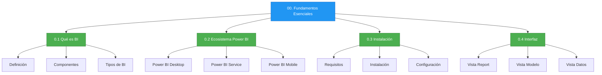

# Módulo 00: Fundamentos Esenciales

## Descripción

Este módulo establece las bases conceptuales para comprender el ecosistema de Business Intelligence y, específicamente, Microsoft Power BI. Aquí aprenderás qué es la inteligencia de negocios, cómo se estructura el ecosistema de Power BI y cómo configurar tu entorno de trabajo.

## Objetivos de Aprendizaje

Al finalizar este módulo serás capaz de:

- Definir Business Intelligence y su importancia estratégica
- Identificar los componentes del ecosistema Power BI
- Instalar y configurar Power BI Desktop
- Navegar por la interfaz de usuario con confianza

## Contenido del Módulo

| # | Archivo | Tema | Tiempo |
|:-:|---------|------|:------:|
| 0.1 | [Qué es Business Intelligence](0.1_Que_es_Business_Intelligence.md) | Definición, componentes, tipos de BI | 60 min |
| 0.2 | [Anatomía del Ecosistema Power BI](0.2_Anatomia_del_Ecosistema_Power_BI.md) | Arquitectura, componentes, flujo de datos | 50 min |
| 0.3 | [Instalación y Configuración](0.3_Instalacion_y_Configuracion.md) | Requisitos, instalación, configuración inicial | 45 min |
| 0.4 | [Recorrido por la Interfaz](0.4_Recorrido_por_la_Interfaz_de_PBI_Desktop.md) | Paneles, vistas, herramientas | 45 min |

## Glosario

| [Glosario del Módulo](00_Glosario_Fundamentos.md) |
|:--------------------------------------------------:|
| Definiciones de todos los términos técnicos del módulo |

## Diagrama de Contenido

## Prerrequisitos

- Ninguno. Este módulo es el punto de partida.

## Siguiente Módulo → [01: Power Query](../01_Alquimia_de_Datos_con_Power_Query/)
