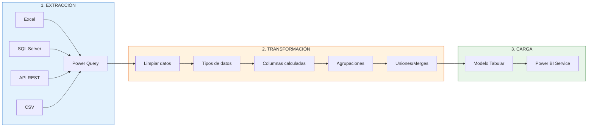
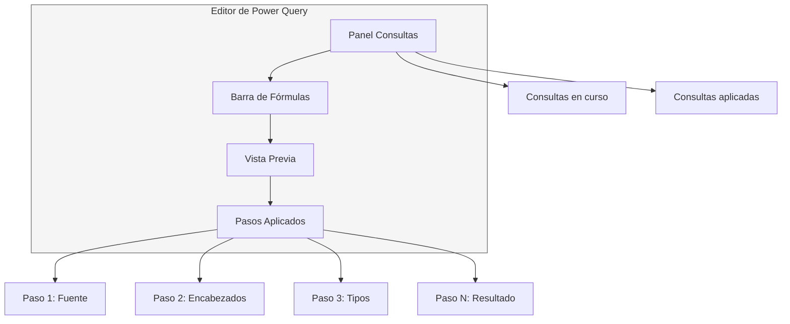

# Módulo 01: Alquimia de Datos con Power Query

## Descripción

Power Query es el motor de Extracción, Transformación y Carga (ETL) integrado en Power BI. Este módulo te enseña a conectar, transformar y preparar datos desde cualquier fuente para su análisis.

## Objetivos de Aprendizaje

Al finalizar este módulo serás capaz de:

- Navegar por el editor de Power Query
- Conectar a múltiples fuentes de datos
- Aplicar transformaciones comunes y avanzadas
- Crear funciones M personalizadas
- Entender los modos de almacenamiento (Import vs DirectQuery)

## Contenido del Módulo

| # | Archivo | Tema | Tiempo |
|:-:|---------|------|:------:|
| 1.1 | [Anatomía del Editor de Power Query](1.1_Anatomia_del_Editor_de_Power_Query.md) | Interfaz, flujo de trabajo, preview | 60 min |
| 1.2 | [Conectores y Modos de Almacenamiento](1.2_Conectores_de_Datos_y_Modos_de_Almacenamiento.md) | Conectores, Import, DirectQuery, Composite | 70 min |
| 1.3 | [Transformaciones Comunes](1.3_Transformaciones_Comunes.md) | Filtrar, agrupar, pivotar, unir | 80 min |
| 1.4 | [Funciones M Personalizadas](1.4_Funciones_M_Personalizadas.md) | Lenguaje M, funciones, parámetros | 90 min |

## Glosario

| [Glosario del Módulo](01_Glosario_Power_Query.md) |
|:--------------------------------------------------:|
| Definiciones de todos los términos técnicos del módulo |

## Diagrama de Flujo ETL

## Esquema del Editor

## Prerrequisitos

- Completar [Módulo 00: Fundamentos Esenciales](../00_Fundamentos_Esenciales/)

## Siguiente Módulo → [02: DAX](../02_El_Corazon_del_Modelo_DAX/)
