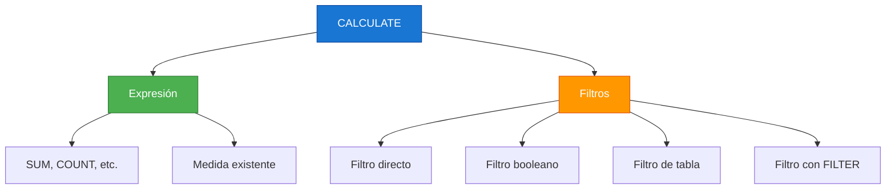
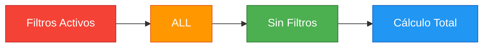

# 2.2.1 Funciones de Filtrado en DAX

## Introducción

Las funciones de filtrado son el corazón de DAX. Permiten modificar el contexto de filtro para calcular métricas personalizadas que van más allá de una simple agregación.

## Funciones Principales

### CALCULATE

`CALCULATE` es la función más importante de DAX. Evalúa una expresión en un contexto de filtro modificado.

```dax
-- Sintaxis básica
CALCULATE(<expresión>, <filtro1>, <filtro2>, ...)

-- Ejemplo: Ventas totales solo para la categoría "Electrónica"
Ventas Electrónica = 
CALCULATE(
    SUM(Ventas[MontoTotal]),
    Productos[Categoria] = "Electrónica"
)
```



### FILTER

`FILTER` devuelve una tabla filtrada según una condición. Es un iterador, por lo que puede ser menos eficiente que otros métodos.

```dax
-- Sintaxis
FILTER(<tabla>, <condición>)

-- Ejemplo: Productos con precio mayor a 100
Productos Caros = 
FILTER(
    Productos,
    Productos[PrecioUnitario] > 100
)

-- Ejemplo combinado con CALCULATE
Ventas Productos Caros = 
CALCULATE(
    SUM(Ventas[MontoTotal]),
    FILTER(
        Productos,
        Productos[PrecioUnitario] > 100
    )
)
```

### ALL

`ALL` elimina todos los filtros de una tabla o columna. Útil para calcular totales generales.

```dax
-- Sintaxis
ALL(<tabla>) o ALL(<tabla>[columna])

-- Ejemplo: Porcentaje de ventas por categoría
% Ventas Por Categoría = 
VAR VentasCategoría = SUM(Ventas[MontoTotal])
VAR VentasTotal = CALCULATE(SUM(Ventas[MontoTotal]), ALL(Productos))
RETURN
    DIVIDE(VentasCategoría, VentasTotal, 0)
```



### ALLEXCEPT

`ALLEXCEPT` elimina todos los filtros EXCEPTO los especificados.

```dax
-- Sintaxis
ALLEXCEPT(<tabla>, <columna1>, <columna2>, ...)

-- Ejemplo: Total por categoría ignorando otros filtros
Total Categoría (Sin Filtros) = 
CALCULATE(
    SUM(Ventas[MontoTotal]),
    ALLEXCEPT(Ventas, Ventas[CategoriaFK])
)
```

## Comparativa de Funciones

| Función | Uso Principal | Rendimiento | Ejemplo |
|---------|---------------|:-----------:|---------|
| `CALCULATE` | Modificar contexto | Alto | `CALCULATE(SUM(...), filtro)` |
| `FILTER` | Filtrar tabla | Medio | `FILTER(tabla, condición)` |
| `ALL` | Eliminar filtros | Alto | `ALL(tabla)` |
| `ALLEXCEPT` | Mantener filtros específicos | Alto | `ALLEXCEPT(tabla, col)` |

## Errores Comunes

```dax
-- ❌ ERROR: Usar FILTER cuando se puede filtro directo
CALCULATE(SUM(Ventas[MontoTotal]), FILTER(Productos, Productos[Categoria] = "A"))

-- ✅ CORRECTO: Filtro directo es más eficiente
CALCULATE(SUM(Ventas[MontoTotal]), Productos[Categoria] = "A")

-- ❌ ERROR: Olvidar que ALL elimina TODOS los filtros
CALCULATE(SUM(Ventas[MontoTotal]), ALL(Ventas))  -- ¡Elimina filtros de fecha!

-- ✅ CORRECTO: Especificar solo la columna necesaria
CALCULATE(SUM(Ventas[MontoTotal]), ALL(Ventas[CategoriaFK]))
```

## Ejercicio Práctico

```dax
-- Calcula el % de participación de cada vendedor en las ventas totales
-- Ignora los filtros de producto pero mantiene los filtros de fecha

% Participación Vendedor = 
VAR VentasVendedor = SUM(Ventas[MontoTotal])
VAR VentasTotal = CALCULATE(
    SUM(Ventas[MontoTotal]),
    ALLEXCEPT(Ventas, Ventas[VendedorFK])
)
RETURN
    DIVIDE(VentasVendedor, VentasTotal, 0)
```

## Glosario de la Sección

| Término | Definición |
|---------|------------|
| **Contexto de filtro** | Conjunto de filtros activos que afectan el cálculo |
| **Iterador** | Función que evalúa expresiones fila por fila |
| **Expresión** | Fórmula DAX que se evalúa |
| **Tabla** | Conjunto de datos sobre el que se aplica el filtro |
