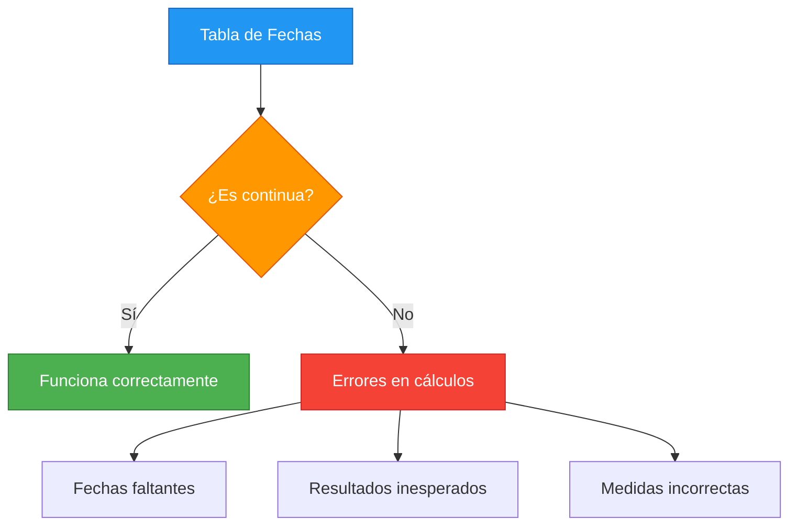
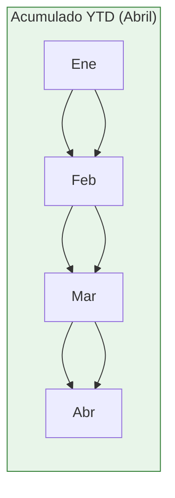

# 2.2.2 Funciones de Time Intelligence en DAX

## Introducción

Las funciones de Time Intelligence permiten realizar cálculos basados en fechas: comparar períodos, acumular valores, calcular crecimientos y mucho más.

## Requisito Fundamental

Para que las funciones de Time Intelligence funcionen correctamente, necesitas una **tabla de fechas** continua y sin gaps.



### Estructura de Tabla de Fechas

```dax
-- Tabla de fechas completa
Calendario = 
ADDCOLUMNS(
    CALENDARAUTO(),
    "Año", YEAR([Date]),
    "Mes", MONTH([Date]),
    "NombreMes", FORMAT([Date], "MMMM"),
    "Trimestre", "T" & QUARTER([Date]),
    "DiaSemana", WEEKDAY([Date], 2),
    "NombreDia", FORMAT([Date], "dddd"),
    "EsFinDeSemana", IF(WEEKDAY([Date], 2) > 5, TRUE, FALSE),
    "AñoMes", FORMAT([Date], "YYYY-MM")
)
```

## Funciones Principales

### TOTALYTD

Acumula valores desde el inicio del año hasta la fecha actual del contexto.

```dax
-- Sintaxis
TOTALYTD(<expresión>, <fechas>, [<filtro>], [<finde año>])

-- Ejemplo: Ventas acumuladas del año
Ventas YTD = 
TOTALYTD(
    SUM(Ventas[MontoTotal]),
    Calendario[Fecha]
)
```



### SAMEPERIODLASTYEAR

Devuelve las fechas del mismo período del año anterior.

```dax
-- Sintaxis
SAMEPERIODLASTYEAR(<fechas>)

-- Ejemplo: Ventas del mismo período año anterior
Ventas PY = 
CALCULATE(
    SUM(Ventas[MontoTotal]),
    SAMEPERIODLASTYEAR(Calendario[Fecha])
)
```

### DATESYTD

Devuelve las fechas del año actual en el contexto.

```dax
-- Sintaxis
DATESYTD(<fechas>, [<finde año>])

-- Ejemplo: Filtrar solo fechas del año actual
Ventas Año Actual = 
CALCULATE(
    SUM(Ventas[MontoTotal]),
    DATESYTD(Calendario[Fecha])
)
```

### DATEADD

Desplaza las fechas un número específico de períodos.

```dax
-- Sintaxis
DATEADD(<fechas>, <intervalo>, <período>)

-- Ejemplo: Ventas hace 3 meses
Ventas Hace 3 Meses = 
CALCULATE(
    SUM(Ventas[MontoTotal]),
    DATEADD(Calendario[Fecha], -3, MONTH)
)
```

### TOTALMTD / TOTALQTD

Acumulados del mes o trimestre actual.

```dax
-- Acumulado del mes
Ventas MTD = 
TOTALMTD(
    SUM(Ventas[MontoTotal]),
    Calendario[Fecha]
)

-- Acumulado del trimestre
Ventas QTD = 
TOTALQTD(
    SUM(Ventas[MontoTotal]),
    Calendario[Fecha]
)
```

## Medidas Comunes de Time Intelligence

```dax
-- 1. Crecimiento YoY
Crecimiento YoY = 
VAR VentasAct = SUM(Ventas[MontoTotal])
VAR VentasAnt = CALCULATE(SUM(Ventas[MontoTotal]), SAMEPERIODLASTYEAR(Calendario[Fecha]))
RETURN
    DIVIDE(VentasAct - VentasAnt, VentasAnt, 0)

-- 2. Mes anterior
Ventas Mes Anterior = 
CALCULATE(
    SUM(Ventas[MontoTotal]),
    DATEADD(Calendario[Fecha], -1, MONTH)
)

-- 3. Acumulado año
Ventas Acumuladas = 
TOTALYTD(
    SUM(Ventas[MontoTotal]),
    Calendario[Fecha]
)

-- 4. Comparativa trimestre
Crecimiento Trimestral = 
VAR VentasTActual = TOTALQTD(SUM(Ventas[MontoTotal]), Calendario[Fecha])
VAR VentasTAnterior = CALCULATE(
    TOTALQTD(SUM(Ventas[MontoTotal]), Calendario[Fecha]),
    DATEADD(Calendario[Fecha], -1, YEAR)
)
RETURN
    DIVIDE(VentasTActual - VentasTAnterior, VentasTAnterior, 0)
```

## Resumen de Funciones

| Función | Período | Ejemplo |
|---------|---------|---------|
| `TOTALYTD` | Año | Acumulado enero-hoy |
| `TOTALMTD` | Mes | Acumulado día 1-hoy |
| `TOTALQTD` | Trimestre | Acumulado trimestre-hoy |
| `SAMEPERIODLASTYEAR` | Año anterior | Mismo período año ant. |
| `DATEADD` | Personalizado | Hace N meses/años |
| `DATESYTD` | Filtrar año | Solo fechas del año |

## Errores Comunes

```dax
-- ❌ ERROR: Usar sin tabla de fechas continua
Ventas YTD = TOTALYTD(SUM(Ventas[MontoTotal]), Ventas[Fecha])  -- Puede fallar

-- ✅ CORRECTO: Usar tabla de fechas dedicada
Ventas YTD = TOTALYTD(SUM(Ventas[MontoTotal]), Calendario[Fecha])

-- ❌ ERROR: Confundir SAMEPERIODLASTYEAR con DATEADD
-- SAMEPERIODLASTYEAR = DATEADD(..., -1, YEAR) pero es más flexible

-- ✅ CORRECTO: Usar SAMEPERIODYEAR para comparación exacta
```
