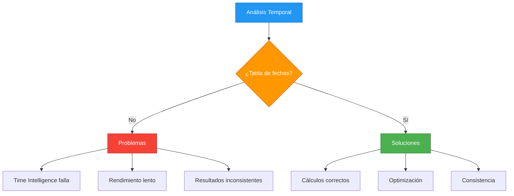
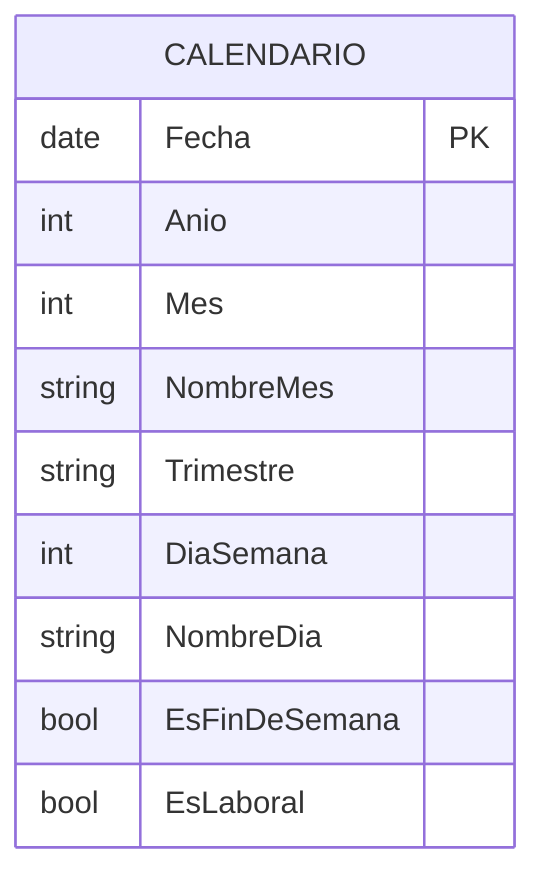
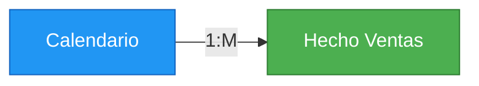

# 2.3.1 Patrón Calendario en DAX

## Introducción

Un patrón de calendario robusto es fundamental para cualquier modelo de datos que requiera análisis temporal. Este patrón crea una tabla de fechas completa y optimizada.

## Por Qué Necesitas una Tabla de Fechas



## Creación de Tabla de Fechas

### Versión Completa

```dax
Calendario = 
VAR FechaInicio = DATE(2020, 1, 1)
VAR FechaFin = DATE(2025, 12, 31)
VAR Fechas = CALENDAR(FechaInicio, FechaFin)
RETURN
ADDCOLUMNS(
    Fechas,
    "Año", YEAR([Date]),
    "Mes", MONTH([Date]),
    "NombreMes", FORMAT([Date], "MMMM"),
    "MesCorto", FORMAT([Date], "MMM"),
    "MesAño", FORMAT([Date], "MM/YYYY"),
    "Trimestre", "T" & QUARTER([Date]),
    "NombreTrimestre", "Trimestre " & QUARTER([Date]),
    "Semana", WEEKNUM([Date], 2),
    "DiaSemana", WEEKDAY([Date], 2),
    "NombreDia", FORMAT([Date], "dddd"),
    "DiaCorto", FORMAT([Date], "ddd"),
    "EsFinDeSemana", IF(WEEKDAY([Date], 2) > 5, TRUE, FALSE),
    "EsLaboral", IF(WEEKDAY([Date], 2) <= 5, TRUE, FALSE),
    "TrimestreAño", "T" & QUARTER([Date]) & " " & YEAR([Date]),
    "SemanaAño", "S" & WEEKNUM([Date], 2) & " " & YEAR([Date])
)
```

### Versión Automática (CALENDARAUTO)

```dax
Calendario Auto = 
VAR Fechas = CALENDARAUTO()
RETURN
ADDCOLUMNS(
    Fechas,
    "Año", YEAR([Date]),
    "Mes", MONTH([Date]),
    "NombreMes", FORMAT([Date], "MMMM"),
    "Trimestre", "T" & QUARTER([Date]),
    "DiaSemana", WEEKDAY([Date], 2),
    "EsFinDeSemana", IF(WEEKDAY([Date], 2) > 5, TRUE, FALSE)
)
```

## Estructura de la Tabla



## Configuración de Relación

```dax
-- La tabla Calendario debe tener relación ONE-TO-MANY con la tabla de hechos
-- Relación: Calendario[Fecha] --> Hecho_Ventas[FechaFK]
```



## Uso con Time Intelligence

```dax
-- Una vez que tienes la tabla de calendario, estas funciones funcionan correctamente:

-- Ventas acumuladas del año
Ventas YTD = TOTALYTD(SUM(Hecho[MontoTotal]), Calendario[Fecha])

-- Mismo período año anterior
Ventas PY = CALCULATE(SUM(Hecho[MontoTotal]), SAMEPERIODLASTYEAR(Calendario[Fecha]))

-- Crecimiento YoY
Crecimiento YoY = 
VAR VentasAct = [Ventas YTD]
VAR VentasAnt = [Ventas PY]
RETURN DIVIDE(VentasAct - VentasAnt, VentasAnt, 0)
```

## Marcas de Fechas Especiales

```dax
-- Agregar fechas especiales al calendario
Calendario Con Festivos = 
ADDCOLUMNS(
    Calendario,
    "EsFestivo", 
        SWITCH(
            TRUE(),
            [Mes] = 1 && [Dia] = 1, TRUE,      -- Año Nuevo
            [Mes] = 12 && [Dia] = 25, TRUE,    -- Navidad
            [Mes] = 5 && [Dia] = 1, TRUE,      -- Día del Trabajo
            [Mes] = 10 && [Dia] = 12, TRUE,    -- Día de la Hispanidad
            FALSE
        )
)
```

## Mejores Prácticas

| Práctica | Descripción |
|----------|-------------|
| Usar `CALENDAR` | Más control sobre rango de fechas |
| Incluir campos de texto | Facilita filtros y visualizaciones |
| Marcar festivos | Permite excluir días no laborables |
| Relación uno-a-muchos | Optimiza rendimiento |
| Evitar `DATEVALUE` | Puede causar problemas de rendimiento |
| Indexar numéricamente | Ayuda a ordenar y filtrar |

## Errores Comunes

```dax
-- ❌ ERROR: Usar CALENDARAUTO sin definir rango
Calendario = CALENDARAUTO()  -- Puede crear demasiadas fechas

-- ✅ CORRECTO: Definir rango explícitamente
Calendario = CALENDAR(DATE(2020,1,1), DATE(2025,12,31))

-- ❌ ERROR: No tener relación con tabla de hechos
-- La tabla de fechas DEBE estar relacionada con la tabla de hechos

-- ✅ CORRECTO: Crear relación en el modelo
```
