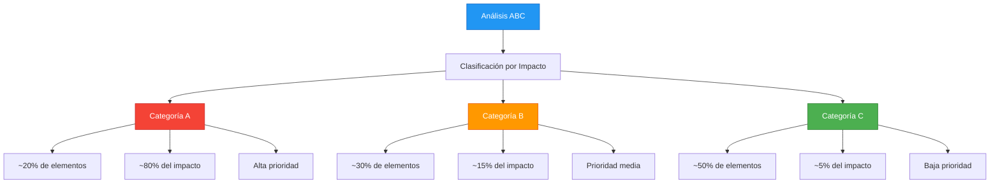
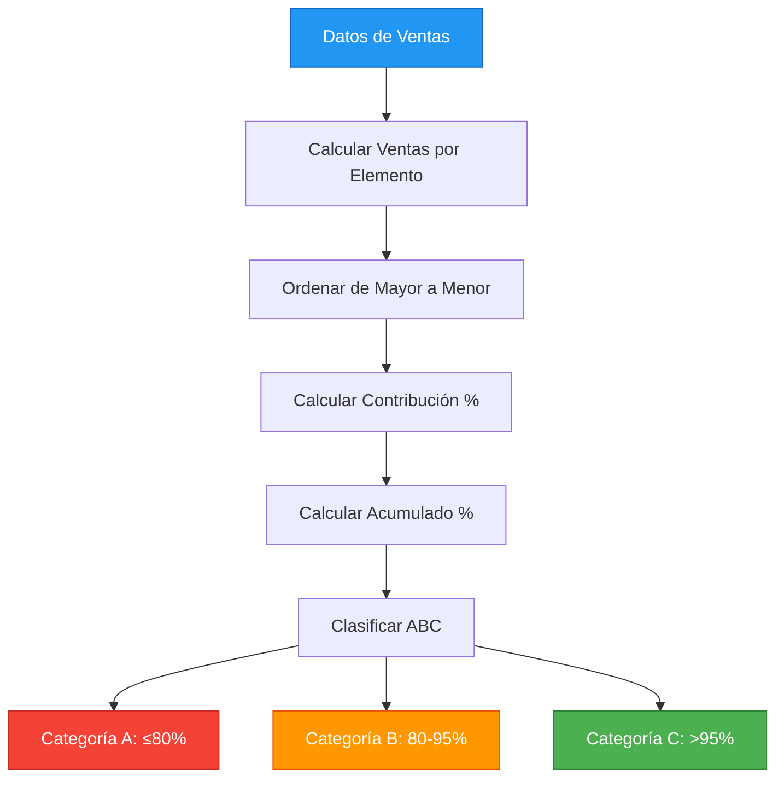

# 2.3.2 Patrón ABC Analysis en DAX

## Introducción

El análisis ABC (también conocido como análisis de Pareto) clasifica elementos según su contribución al total. Es fundamental para priorizar esfuerzos de análisis y gestión.

## Concepto del Análisis ABC



## Implementación en DAX

### Paso 1: Calcular Contribución por Elemento

```dax
-- Primero, calcula la contribución de cada elemento al total
Contribución % = 
VAR VentasElemento = SUM(Ventas[MontoTotal])
VAR VentasTotal = CALCULATE(SUM(Ventas[MontoTotal]), ALL(Ventas))
RETURN
    DIVIDE(VentasElemento, VentasTotal, 0)
```

### Paso 2: Calcular Contribución Acumulada

```dax
-- Calcula la contribución acumulada ordenada de mayor a menor
Contribución Acumulada = 
VAR VentasElemento = SUM(Ventas[MontoTotal])
VAR TodosLosElementos = 
    ADDCOLUMNS(
        VALUES(Productos[ProductoID]),
        "Ventas", CALCULATE(SUM(Ventas[MontoTotal]))
    )
VAR ElementosMayoresOIguales = 
    FILTER(
        TodosLosElementos,
        [Ventas] >= VentasElemento
    )
VAR ContribuciónAcumulada = 
    SUMX(ElementosMayoresOIguales, [Ventas])
VAR VentasTotal = CALCULATE(SUM(Ventas[MontoTotal]), ALL(Ventas))
RETURN
    DIVIDE(ContribuciónAcumulada, VentasTotal, 0)
```

### Paso 3: Clasificar ABC

```dax
-- Clasifica cada elemento en categoría A, B o C
Clasificación ABC = 
VAR Contribución = [Contribución Acumulada]
RETURN
    SWITCH(
        TRUE(),
        Contribución <= 0.8, "A",
        Contribución <= 0.95, "B",
        "C"
    )
```

### Medida Completa (Alternativa Simplificada)

```dax
-- Versión simplificada usando ranking
Clasificación ABC Simple = 
VAR VentasElemento = SUM(Ventas[MontoTotal])
VAR VentasTotal = CALCULATE(SUM(Ventas[MontoTotal]), ALL(Ventas))
VAR Contribución = DIVIDE(VentasElemento, VentasTotal, 0)
VAR Ranking = RANKX(ALL(Ventas[ProductoFK]), VentasElemento, , DESC, Dense)
VAR TotalElementos = CALCULATE(DISTINCTCOUNT(Ventas[ProductoFK]), ALL(Ventas))
VAR PercentilRanking = DIVIDE(Ranking, TotalElementos, 0)
RETURN
    SWITCH(
        TRUE(),
        PercentilRanking <= 0.2, "A",
        PercentilRanking <= 0.5, "B",
        "C"
    )
```

## Diagrama de Implementación



## Métricas de Resumen por Categoría

```dax
-- Ventas totales por categoría ABC
Ventas por Categoría ABC = 
SUMX(
    VALUES(Ventas[ProductoFK]),
    SUM(Ventas[MontoTotal])
)

-- Cantidad de productos por categoría
Productos por ABC = 
COUNTROWS(
    FILTER(
        VALUES(Productos[ProductoID]),
        [Clasificación ABC] = "A"  -- Cambiar por B o C
    )
)

-- Promedio de ventas por categoría
Promedio Ventas ABC = 
AVERAGEX(
    FILTER(
        VALUES(Productos[ProductoID]),
        [Clasificación ABC] = "A"
    ),
    SUM(Ventas[MontoTotal])
)
```

## Ejemplo Práctico

### Datos de Ejemplo

| Producto | Ventas | Contribución | Acumulado | Categoría |
|----------|-------:|-------------:|----------:|:---------:|
| Producto A | $50,000 | 40% | 40% | A |
| Producto B | $30,000 | 24% | 64% | A |
| Producto C | $20,000 | 16% | 80% | A |
| Producto D | $12,500 | 10% | 90% | B |
| Producto E | $7,500 | 6% | 96% | B |
| Producto F | $5,000 | 4% | 100% | C |

### Análisis

- **Categoría A** (3 productos, 50%): Representan el 80% de las ventas
- **Categoría B** (2 productos, 33%): Representan el 16% de las ventas
- **Categoría C** (1 producto, 17%): Representa el 4% de las ventas

## Usos del Análisis ABC

| Uso | Aplicación |
|-----|------------|
| Gestión de inventario | Priorizar stock de productos A |
| Análisis de clientes | Enfocar esfuerzos en clientes A |
| Optimización de gastos | Reducir tiempo en productos C |
| Planificación de ventas | Establecer metas por categoría |
| Negociación con proveedores | Priorizar negociaciones con proveedores A |

## Errores Comunes

```dax
-- ❌ ERROR: No usar ALL para calcular el total
Contribución = DIVIDE(SUM(Ventas[Monto]), SUM(Ventas[Monto]))  -- Siempre = 1

-- ✅ CORRECTO: Usar ALL para ignorar filtros
Contribución = DIVIDE(SUM(Ventas[Monto]), CALCULATE(SUM(Ventas[Monto]), ALL(Ventas)))

-- ❌ ERROR: No manejar empates en el ranking
-- Puedes usar RANKX con Dense para manejar empates

-- ✅ CORRECTO: Especificar manejo de empates
RANKX(ALL(Ventas), [Ventas], , DESC, Dense)
```
