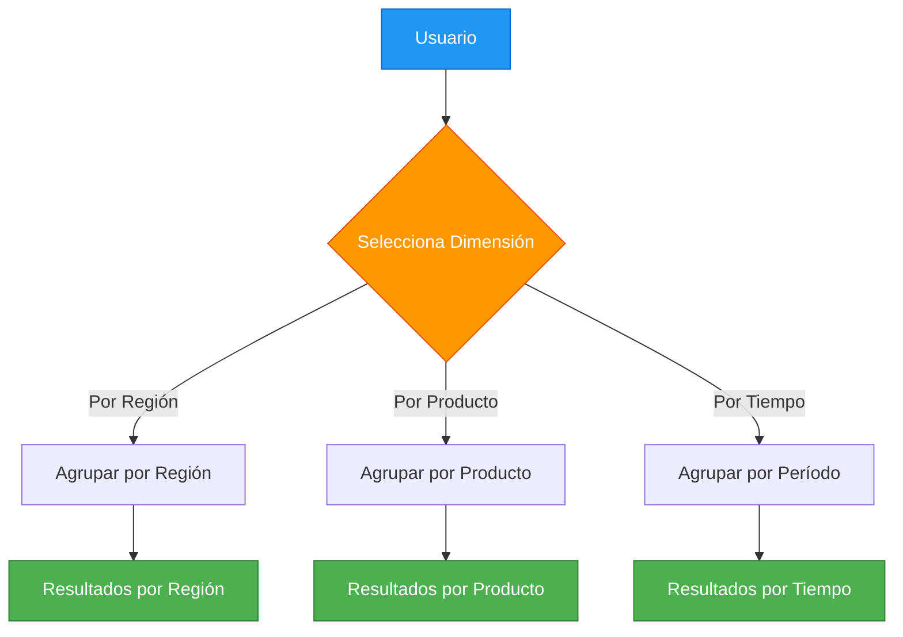
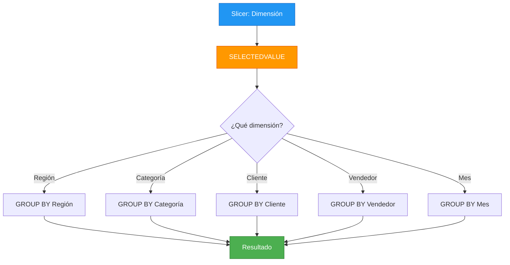
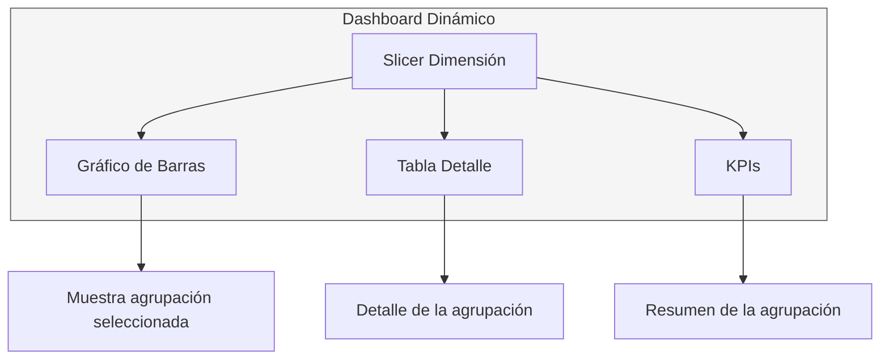

# 2.3.3 Patrón Dynamic Segmentation en DAX

## Introducción

La segmentación dinámica permite al usuario seleccionar dinámicamente cómo quiere agrupar y analizar los datos. Es extremadamente útil para dashboards interactivos.

## Concepto



## Implementación Paso a Paso

### Paso 1: Crear Tabla de Parámetros

```dax
-- Tabla que contiene las opciones de segmentación
Dimensiones Análisis = 
DATATABLE(
    "Dimensión", STRING,
    "Orden", INTEGER,
    {
        {"Región", 1},
        {"Categoría", 2},
        {"Cliente", 3},
        {"Vendedor", 4},
        {"Mes", 5}
    }
)
```

### Paso 2: Crear Medida de Valor

```dax
-- Medida base que será segmentada dinámicamente
Valor Seleccionado = 
VAR DimensiónActual = SELECTEDVALUE('Dimensiones Análisis'[Dimensión])
VAR Resultado = 
    SWITCH(
        DimensiónActual,
        "Región", SUM(Ventas[MontoTotal]),
        "Categoría", SUM(Ventas[MontoTotal]),
        "Cliente", SUM(Ventas[MontoTotal]),
        "Vendedor", SUM(Ventas[MontoTotal]),
        "Mes", SUM(Ventas[MontoTotal]),
        SUM(Ventas[MontoTotal])  -- Valor por defecto
    )
RETURN
    Resultado
```

### Paso 3: Crear Medida de Agrupación

```dax
-- Medida que devuelve el nombre de la agrupación seleccionada
Nombre Agrupación = 
VAR DimensiónActual = SELECTEDVALUE('Dimensiones Análisis'[Dimensión])
VAR Resultado = 
    SWITCH(
        DimensiónActual,
        "Región", FIRSTNONBLANK(Ventas[Region], 1),
        "Categoría", FIRSTNONBLANK(Productos[Categoria], 1),
        "Cliente", FIRSTNONBLANK(Clientes[Nombre], 1),
        "Vendedor", FIRSTNONBLANK(Vendedores[Nombre], 1),
        "Mes", FIRSTNONBLANK(Calendario[NombreMes], 1),
        "Total"
    )
RETURN
    Resultado
```

## Implementación Avanzada con SWITCH

```dax
-- Medida completa que retorna valores según la dimensión seleccionada
Ventas por Dimensión = 
VAR DimensiónActual = SELECTEDVALUE('Dimensiones Análisis'[Dimensión])
VAR Resultado = 
    SWITCH(
        DimensiónActual,
        
        -- Opción 1: Por Región
        "Región",
            SUMX(
                VALUES(Ventas[Region]),
                SUM(Ventas[MontoTotal])
            ),
        
        -- Opción 2: Por Categoría
        "Categoría",
            SUMX(
                VALUES(Productos[Categoria]),
                SUM(Ventas[MontoTotal])
            ),
        
        -- Opción 3: Por Cliente
        "Cliente",
            SUMX(
                VALUES(Clientes[ClienteID]),
                SUM(Ventas[MontoTotal])
            ),
        
        -- Opción 4: Por Vendedor
        "Vendedor",
            SUMX(
                VALUES(Vendedores[VendedorID]),
                SUM(Ventas[MontoTotal])
            ),
        
        -- Opción 5: Por Mes
        "Mes",
            SUMX(
                VALUES(Calendario[Mes]),
                SUM(Ventas[MontoTotal])
            ),
        
        -- Valor por defecto
        SUM(Ventas[MontoTotal])
    )
RETURN
    Resultado
```

## Diagrama de Flujo



## Medidas Complementarias

```dax
-- Porcentaje del total para cada agrupación
% del Total = 
VAR ValorActual = [Ventas por Dimensión]
VAR ValorTotal = CALCULATE([Ventas por Dimensión], ALLSELECTED())
RETURN
    DIVIDE(ValorActual, ValorTotal, 0)

-- Ranking dentro de la agrupación
Ranking = 
RANKX(
    ALLSELECTED(Ventas[Region]),  -- Cambiar según dimensión
    [Ventas por Dimensión],
    ,
    DESC,
    Dense
)

-- Promedio por agrupación
Promedio por Agrupación = 
AVERAGEX(
    VALUES(Ventas[Region]),  -- Cambiar según dimensión
    [Ventas por Dimensión]
)
```

## Uso en un Dashboard



## Ejemplo Práctico: Análisis de Ventas

### Escenario
Un gerente quiere ver las ventas:
1. **Por región** para ver rendimiento geográfico
2. **Por categoría** para ver qué productos venden más
3. **Por vendedor** para evaluar desempeño del equipo

### Solución

```dax
-- Crear tabla de dimensiones
Dimensiones Análisis = DATATABLE(
    "Dimensión", STRING,
    "Icono", STRING,
    {
        {"Región", "🌍"},
        {"Categoría", "📦"},
        {"Vendedor", "👤"},
        {"Tiempo", "📅"}
    }
)

-- Medida principal
Ventas Dinámicas = 
VAR Dimensión = SELECTEDVALUE('Dimensiones Análisis'[Dimensión])
RETURN
    SWITCH(
        Dimensión,
        "Región", CALCULATE(SUM(Ventas[MontoTotal]), ALLSELECTED(Clientes[Region])),
        "Categoría", CALCULATE(SUM(Ventas[MontoTotal]), ALLSELECTED(Productos[Categoria])),
        "Vendedor", CALCULATE(SUM(Ventas[MontoTotal]), ALLSELECTED(Vendedores[Nombre])),
        "Tiempo", CALCULATE(SUM(Ventas[MontoTotal]), ALLSELECTED(Calendario[Mes])),
        SUM(Ventas[MontoTotal])
    )
```

## Errores Comunes

```dax
-- ❌ ERROR: No manejar SELECTEDVALUE cuando hay múltiples selecciones
VAR Dimensión = SELECTEDVALUE('Dimensiones Análisis'[Dimensión])  -- Puede ser BLANK

-- ✅ CORRECTO: Usar FIRSTNONBLANK o VALUE con valor por defecto
VAR Dimensión = FIRSTNONBLANK('Dimensiones Análisis'[Dimensión], "Región")

-- ❌ ERROR: Olvidar ALLSELECTED para métricas de comparative
-- Sin ALLSELECTED, el porcentaje siempre será 100%

-- ✅ CORRECTO: Usar ALLSELECTED para comparar con el total visible
DIVIDE(ValorActual, CALCULATE(ValorActual, ALLSELECTED()))
```

## Mejores Prácticas

| Práctica | Descripción |
|----------|-------------|
| Usar `SELECTEDVALUE` | Captura la selección del usuario |
| Incluir valor por defecto | Maneja BLANK cuando no hay selección |
| Usar `ALLSELECTED` | Para métricas comparativas |
| Mantener medidas simples | Una medida por dimensión es más claro |
| Documentar dimensiones | Incluir descripciones en la tabla de parámetros |
