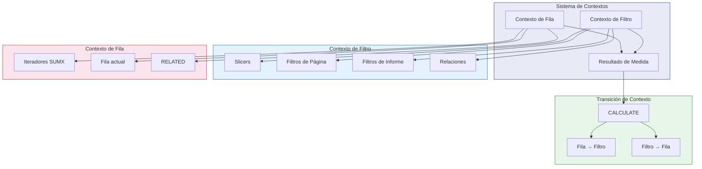

# Módulo 02: El Corazón del Modelo DAX

## Descripción

DAX (Data Analysis Expressions) es el lenguaje de fórmulas que alimenta el motor de cálculo de Power BI. Este módulo profundiza en los conceptos fundamentales, funciones esenciales y patrones avanzados de DAX.

## Objetivos de Aprendizaje

Al finalizar este módulo serás capaz de:

- Dominar el contexto de filtro y contexto de fila
- Implementar la transición de contexto
- Crear medidas DAX eficientes y reutilizables
- Aplicar patrones DAX para resolver problemas comunes de negocio

## Contenido del Módulo

### 2.1 Conceptos Fundamentales

| # | Archivo | Tema | Tiempo |
|:-:|---------|------|:------:|
| 2.1.1 | [Contexto de Filtro](2.1_Conceptos_Fundamentales/2.1.1_Contexto_de_Filtro.md) | Qué es, cómo se establece, ejemplos | 75 min |
| 2.1.2 | [Contexto de Fila](2.1_Conceptos_Fundamentales/2.1.2_Contexto_de_Fila.md) | Iteradores, fila actual, ejemplos | 70 min |
| 2.1.3 | [Transición de Contexto](2.1_Conceptos_Fundamentales/2.1.3_Transicion_de_Contexto.md) | Converting row to filter context | 65 min |

### 2.2 Funciones DAX Esenciales

| # | Archivo | Tema | Tiempo |
|:-:|---------|------|:------:|
| 2.2.1 | [Funciones de Filtrado](2.2_Funciones_DAX_Esenciales/2.2.1_Funciones_de_Filtrado.md) | CALCULATE, FILTER, ALL, ALLEXCEPT | 80 min |
| 2.2.2 | [Funciones de Time Intelligence](2.2_Funciones_DAX_Esenciales/2.2.2_Funciones_de_Time_Intelligence.md) | TOTALYTD, SAMEPERIODLASTYEAR, DATESYTD | 75 min |
| 2.2.3 | [Funciones de Texto y Fechas](2.2_Funciones_DAX_Esenciales/2.2.3_Funciones_de_Texto_y_Fechas.md) | FORMAT, DATE, YEAR, MONTH | 60 min |

### 2.3 Patrones DAX Avanzados

| # | Archivo | Tema | Tiempo |
|:-:|---------|------|:------:|
| 2.3.1 | [Patrón Calendario](2.3_Patrones_DAX_Avanzados/2.3.1_Patron_Calendario.md) | Tabla de fechas, AUTOCALENDAR | 50 min |
| 2.3.2 | [Patrón ABC Analysis](2.3_Patrones_DAX_Avanzados/2.3.2_Patron_ABC_Analysis.md) | Clasificación pareto | 45 min |
| 2.3.3 | [Patrón Dynamic Segmentation](2.3_Patrones_DAX_Avanzados/2.3.3_Patron_Dynamic_Segmentation.md) | Segmentación dinámica | 55 min |

## Diagrama de Conceptos DAX

## Jerarquía de Funciones DAX

```mermaid
flowchart TD
    DAX[DAX] --> Filter[Filtrado]
    DAX --> Agg[Agregación]
    DAX --> TI[Time Intelligence]
    DAX --> Logic[Lógica]
    DAX --> Text[Texto]
    
    Filter --> CALCULATE
    Filter --> FILTER
    Filter --> ALL
    Filter --> ALLEXCEPT
    
    Agg --> SUM
    Agg --> AVERAGE
    Agg --> COUNT
    Agg --> DISTINCTCOUNT
    
    TI --> TOTALYTD
    TI --> SAMEPERIODLASTYEAR
    TI --> DATESYTD
    TI --> DATEADD
    
    Logic --> IF
    Logic --> SWITCH
    Logic --> VAR
    
    Text --> FORMAT
    Text --> CONCATENATE
    Text --> LEFT
    Text --> LEN
    
    style DAX fill:#ff5722,stroke:#bf360c,color:#fff
    style Filter fill:#2196f3,stroke:#1565c0,color:#fff
    style Agg fill:#4caf50,stroke:#2e7d32,color:#fff
    style TI fill:#9c27b0,stroke:#6a1b9a,color:#fff
    style Logic fill:#ff9800,stroke:#e65100,color:#fff
    style Text fill:#607d8b,stroke:#37474f,color:#fff
```

## Prerrequisitos

- Completar [Módulo 01: Power Query](../01_Alquimia_de_Datos_con_Power_Query/)
- Conocimientos básicos de tablas y relaciones

## Siguiente Módulo → [03: Modelo de Datos](../03_Arquitectura_del_Modelo_de_Datos/)
