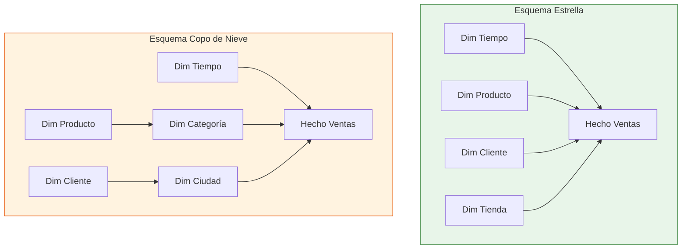
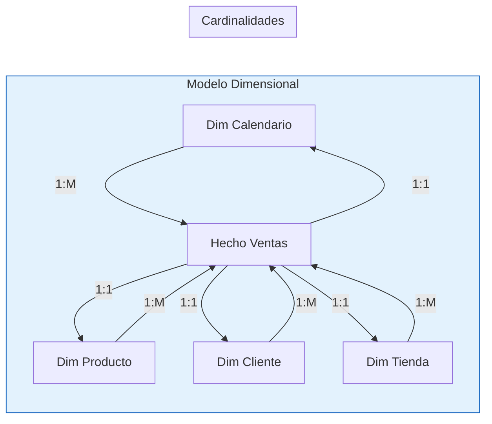

# Módulo 03: Arquitectura del Modelo de Datos

## Descripción

Un modelo de datos bien diseñado es la base de cualquier solución Power BI exitosa. Este módulo cubre los principios del modelado dimensional, tipos de relaciones y estrategias de optimización.

## Objetivos de Aprendizaje

Al finalizar este módulo serás capaz de:

- Diseñar modelos dimensionales eficientes
- Configurar relaciones y cardinalidades correctas
- Distinguir entre esquema estrella y copo de nieve
- Optimizar el rendimiento del modelo

## Contenido del Módulo

| # | Archivo | Tema | Tiempo |
|:-:|---------|------|:------:|
| 3.1 | [Fundamentos del Modelado Dimensional](3.1_Fundamentos_del_Modelado_Dimensional.md) | Tablas de hechos, dimensiones, granularidad | 70 min |
| 3.2 | [Relaciones y Cardinalidades](3.2_Relaciones_y_Cardinalidades.md) | Tipos, comportamientos, activación | 65 min |
| 3.3 | [Esquemas Estrella y Copo de Nieve](3.3_Esquemas_Estrella_y_Copo_de_Nieve.md) | Comparación, ventajas, cuándo usar cada uno | 50 min |
| 3.4 | [Optimización y Agregaciones](3.4_Optimizacion_y_Agregaciones.md) | Rendimiento, tablas resumen, almacenamiento | 60 min |

## Tipos de Modelos

## Diagrama de Relaciones

## Prerrequisitos

- Completar [Módulo 02: DAX](../02_El_Corazon_del_Modelo_DAX/)

## Siguiente Módulo → [04: Visualización](../04_Visualizacion_y_Storytelling_con_Datos/)
