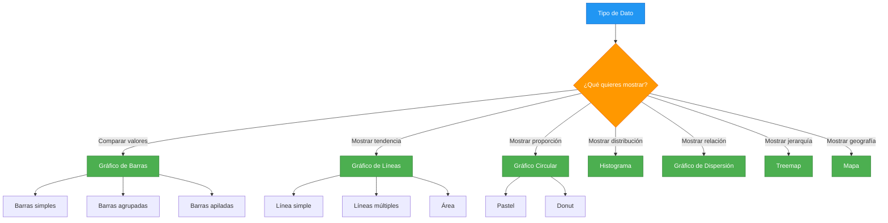
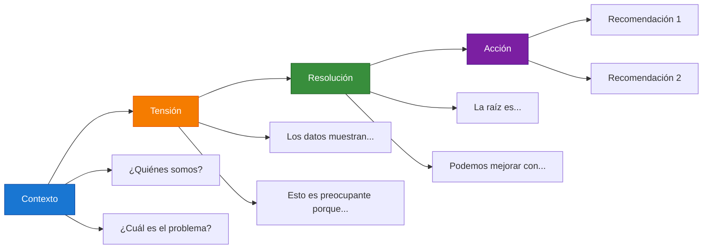

# Módulo 04: Visualización y Storytelling con Datos

## Descripción

La visualización efectiva transforma datos complejos en historias comprensibles. Este módulo cubre los principios de diseño, técnicas de storytelling y buenas prácticas para crear dashboards impactantes.

## Objetivos de Aprendizaje

Al finalizar este módulo serás capaz de:

- Aplicar principios de diseño visual basados en evidencia
- Seleccionar el tipo de gráfico adecuado para cada dato
- Construir narrativas visuales coherentes
- Diseñar dashboards profesionales y accesibles

## Contenido del Módulo

| # | Archivo | Tema | Tiempo |
|:-:|---------|------|:------:|
| 4.1 | [Principios de Visualización Efectiva](4.1_Principios_de_Visualizacion_Efectiva.md) | Gestalt, color, pre-atención, layouts | 80 min |
| 4.2 | [Construcción de Narrativas con Datos](4.2_Construccion_de_Narrativas_con_Datos.md) | Storytelling, estructura, flujo | 60 min |
| 4.3 | [Diseño de Dashboards Profesionales](4.3_Diseno_de_Dashboards_Profesionales.md) | Layout, consistencia, responsive | 70 min |
| 4.4 | [Accesibilidad en Visualización](4.4_Accesibilidad_en_Visualizacion.md) | WCAG, daltonismo, alternativas | 45 min |

## Tipos de Gráficos y Uso Recomendado

## Flujo de Storytelling

## Paleta de Colores Recomendada

| Uso | Color Hex | Nombre | Aplicación |
|-----|:---------:|--------|------------|
| Primario | `#1976d2` | Azul | Títulos, elementos principales |
| Secundario | `#4caf50` | Verde | Valores positivos |
| Terciario | `#ff9800` | Naranja | Advertencias, tendencias |
| Alerta | `#f44336` | Rojo | Valores negativos, errores |
| Neutro | `#757575` | Gris | Texto secundario, bordes |
| Fondo | `#fafafa` | Gris claro | Fondos de paneles |

## Prerrequisitos

- Completar [Módulo 03: Modelo de Datos](../03_Arquitectura_del_Modelo_de_Datos/)

## Siguiente Módulo → [05: Power BI Service](../05_Power_BI_Service_y_Colaboracion/)
