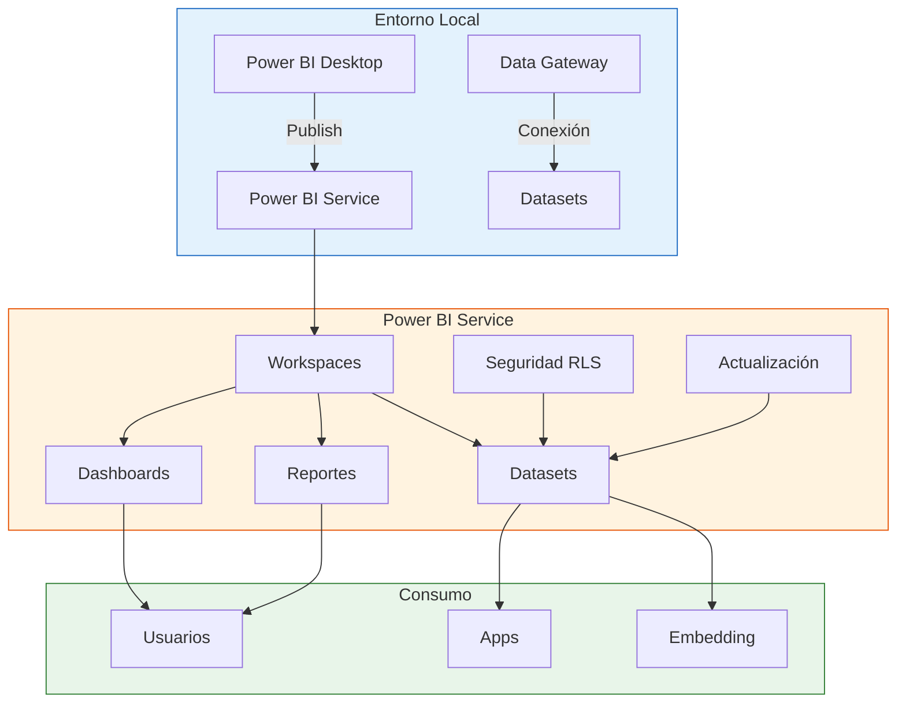
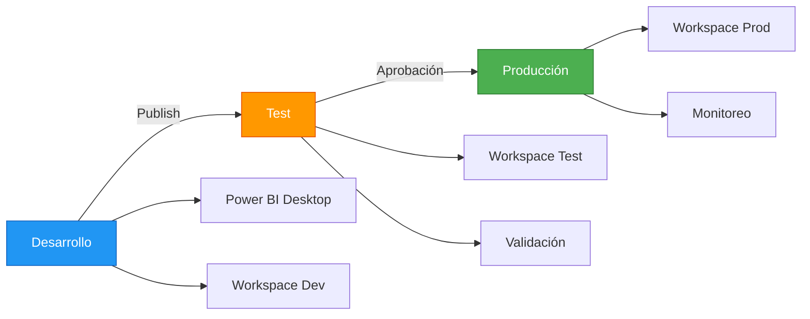

# Módulo 05: Power BI Service y Colaboración

## Descripción

Power BI Service es la plataforma en la nube que permite publicar, compartir y colaborar en reportes. Este módulo cubre deployment, workspaces, seguridad y administración empresarial.

## Objetivos de Aprendizaje

Al finalizar este módulo serás capaz de:

- Publicar y distribuir reportes en Power BI Service
- Gestionar workspaces y permisos
- Implementar seguridad a nivel de fila (RLS)
- Configurar data gateways para datos locales

## Contenido del Módulo

| # | Archivo | Tema | Tiempo |
|:-:|---------|------|:------:|
| 5.1 | [Deployment y Publicación](5.1_Deployment_y_Publicacion.md) | Publish, actualización, distribución | 60 min |
| 5.2 | [Colaboración y Workspaces](5.2_Colaboracion_y_Gestion_de_Workspaces.md) | Espacios de trabajo, permisos, packs | 55 min |
| 5.3 | [Seguridad y Administración](5.3_Seguridad_y_Administracion.md) | RLS, audit, cumplimiento | 65 min |
| 5.4 | [Data Gateways](5.4_Data_Gateways.md) | Puente local, configuración, modos | 50 min |
| 5.5 | [Pipelines y Desarrollo](5.5_Pipelines_y_Desarrollo.md) | CI/CD, ambientes, despliegue | 55 min |

## Arquitectura de Power BI Service

## Flujo de Deployment

## Prerrequisitos

- Completar [Módulo 04: Visualización](../04_Visualizacion_y_Storytelling_con_Datos/)
- Cuenta de Power BI Service (gratuita o premium)

## Siguiente Módulo → [06: Gobernanza](../06_Gobernanza_y_Escalabilidad_Empresarial/)
