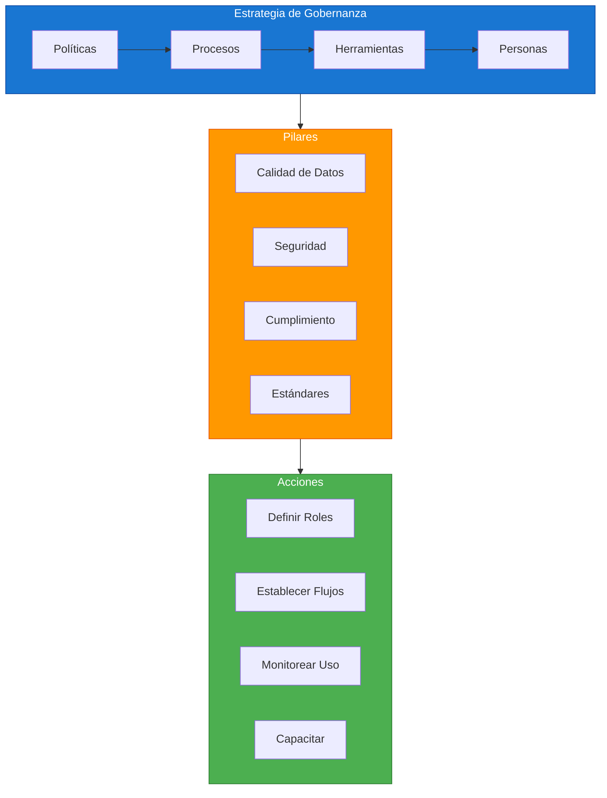
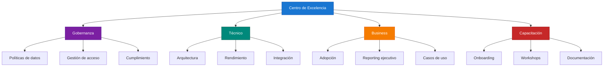

# Módulo 06: Gobernanza y Escalabilidad Empresarial

## Descripción

La gobernanza de datos garantiza que la información sea confiable, segura y accesible. Este módulo cubre estrategias de gobernanza, arquitectura escalable y la implementación de un Centro de Excelencia (COE).

## Objetivos de Aprendizaje

Al finalizar este módulo serás capaz de:

- Diseñar una estrategia de gobernanza de datos
- Implementar un Centro de Excelencia (COE)
- Escalar soluciones Power BI a nivel empresarial
- Monitorear y optimizar el rendimiento

## Contenido del Módulo

| # | Archivo | Tema | Tiempo |
|:-:|---------|------|:------:|
| 6.1 | [Estrategias de Gobernanza](6.1_Estrategias_de_Gobernanza.md) | Marcos de trabajo, políticas, roles | 75 min |
| 6.2 | [Arquitectura Escalable](6.2_Arquitectura_Escalable.md) | Patrones, modularidad, distribución | 65 min |
| 6.3 | [Centro de Excelencia (COE)](6.3_Centro_de_Excelencia_COE.md) | Estructura, procesos, métricas | 70 min |
| 6.4 | [Lineamientos de Nomenclatura](6.4_Lineamientos_de_Nomenclatura.md) | Convenciones, estándares, gobierno | 40 min |
| 6.5 | [Monitoreo y Optimización](6.5_Monitoreo_y_Optimizacion.md) | Métricas, alertas, ajuste | 55 min |

## Marco de Gobernanza

## Estructura del COE

## Prerrequisitos

- Completar [Módulo 05: Power BI Service](../05_Power_BI_Service_y_Colaboracion/)
- Experiencia en proyectos de datos empresariales

## Siguiente Módulo → [07: Casos de Estudio](../07_Casos_de_Estudio_Completos/)
