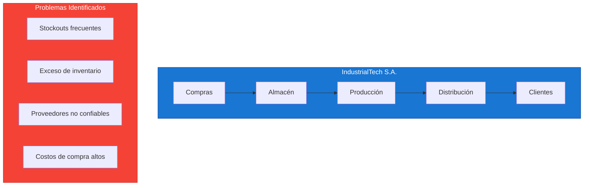
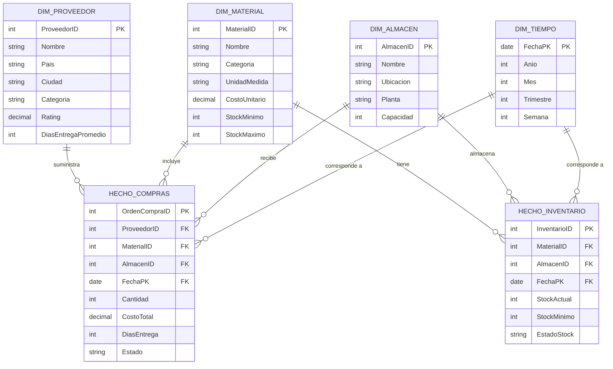

# Caso de Estudio: Compras y Cadena de Suministro

## Resumen Ejecutivo

| Campo | Detalle |
|-------|---------|
| **Industria** | Manufactura / Distribución |
| **Objetivo** | Optimizar proceso de compras y gestionar cadena de suministro |
| **Datos** | 2 años de órdenes de compra, 200 proveedores, 5,000 productos |
| **Herramientas** | Power BI Desktop + Power BI Service + Azure SQL |
| **Nivel** | Intermedio-Avanzado |
| **Tiempo estimado** | 6 horas |

---

## Contexto del Negocio

### Empresa Ficticia: IndustrialTech S.A.



- **Sector:** Manufactura de componentes electrónicos
- **Empleados:** 800 personas
- **Plantas:** 3 ubicaciones (México, Colombia, Chile)
- **Facturación:** $45M anuales
- **Proveedores:** 200+ activos
- **SKUs:** 5,000 productos

### Problemas Críticos

| Problema | Impacto | Costo Estimado |
|----------|---------|:--------------:|
| Stockouts en materias primas críticas | Paradas de producción | $2.1M/año |
| Exceso de inventario obsoleto | Capital inmovilizado | $1.8M/año |
| Falta de visibilidad de proveedores | Decisiones reactivas | $800K/año |
| Procesos de compra manuales | Ineficiencia operativa | $500K/año |
| Demora en aprobaciones | Retrasos en producción | $400K/año |

---

## Objetivos del Proyecto

### Objetivos Estratégicos

1. **Reducir stockouts** en un 60% en materiales críticos
2. **Disminuir inventario** obsoleto en un 40%
3. **Mejorar ragating de proveedores** con datos objetivos
4. **Optimizar costos de compra** en un 15%
5. **Automatizar procesos** de aprobación de órdenes

### Objetivos Analíticos

- Dashboard de visibilidad de cadena de suministro
- Análisis ABC de inventario
- Evaluación de desempeño de proveedores
- Optimización de puntos de reorden
- Predicción de demanda

---

## Modelo de Datos

### Diagrama Entidad-Relación



---

## Estructura de Datos

### Fuentes de Datos

#### 1. Sistema ERP (SAP/Oracle)

```text
Tablas principales:
├── HECHO_COMPRAS (Fact Table)
│   ├── OrdenCompraID (PK)
│   ├── ProveedorID (FK)
│   ├── MaterialID (FK)
│   ├── AlmacenID (FK)
│   ├── FechaOrden (FK)
│   ├── FechaEntrega
│   ├── CantidadOrdenada
│   ├── CantidadRecibida
│   ├── CostoUnitario
│   ├── CostoTotal
│   ├── DiasEntregaReal
│   ├── DiasEntregaPrometido
│   └── EstadoOrden
│
├── DIM_PROVEEDOR
│   ├── ProveedorID (PK)
│   ├── NombreProveedor
│   ├── Pais
│   ├── Ciudad
│   ├── CategoriaProveedor
│   ├── Calificacion
│   ├── TiempoRespuestaHoras
│   └── Certificaciones
│
├── DIM_MATERIAL
│   ├── MaterialID (PK)
│   ├── CodigoMaterial
│   ├── NombreMaterial
│   ├── CategoriaID (FK)
│   ├── UnidadMedida
│   ├── CostoEstandar
│   ├── TiempoEntregaProveedor
│   ├── StockSeguridad
│   └── PuntoReorden
│
└── DIM_ALMACEN
    ├── AlmacenID (PK)
    ├── NombreAlmacen
    ├── Planta
    ├── Ciudad
    ├── CapacidadM3
    └── CostoAlmacenamiento
```

#### 2. Datos de Proveedores Externos

- Catálogos de proveedores
- Certificaciones de calidad
- Ratings de desempeño
- Precios de mercado

#### 3. Datos de Demanda

- Pronósticos de producción
- Órdenes de clientes
- Historial de consumo
- Estacionalidad

---

## Métricas Clave (KPIs)

### Tablero de Compras

| KPI | Fórmula DAX | Meta | Descripción |
|-----|-------------|:----:|-------------|
| **Fill Rate** | `DIVIDE(CantRecibida, CantOrdenada)` | >95% | % de órdenes completadas |
| **Lead Time Promedio** | `AVG(DiasEntrega)` | <7 días | Tiempo promedio de entrega |
| **Proveedor Score** | `Calificacion * Factor` | >4.0 | Calificación compuesta |
| **Costo de Compra** | `SUM(CostoTotal)` | -10% | Gasto total en compras |
| **Inventario Obsoleto** | `Stock > 180 días` | <5% | Productos sin movimiento |
| ** stockouts** | `CasoStockOut / TotalDias` | <2% | Días sin stock disponible |

### Medidas DAX Principales

```dax
// 1. Fill Rate (% de cumplimiento)
Fill Rate = 
VAR CantidadRecibida = SUM(HechoCompras[CantidadRecibida])
VAR CantidadOrdenada = SUM(HechoCompras[CantidadOrdenada])
RETURN
    DIVIDE(CantidadRecibida, CantidadOrdenada, 0)

// 2. Lead Time Promedio
Lead Time Promedio = 
AVERAGEX(
    VALUES(HechoCompras[ProveedorID]),
    CALCULATE(AVERAGE(HechoCompras[DiasEntregaReal]))
)

// 3. Días de Stock (Inventory Days)
Dias de Stock = 
VAR StockActual = SUM(HechoInventario[StockActual])
VAR ConsumoDiario = CALCULATE(
    SUM(HechoCompras[CantidadRecibida]),
    DATESINPERIODO(DimTiempo[FechaPK], TODAY(), -30, DAY)
) / 30
RETURN
    DIVIDE(StockActual, ConsumoDiario, 0)

// 4. Score de Proveedor
Score Proveedor = 
VAR Calidad = CALCULATE(AVERAGE(HechoCompras[CantidadRecibida]) / 
    AVERAGE(HechoCompras[CantidadOrdenada]))
VAR Tiempo = 1 - DIVIDE(
    CALCULATE(AVERAGE(HechoCompras[DiasEntregaReal])) - 
    CALCULATE(AVERAGE(HechoCompras[DiasEntregaPrometido])),
    CALCULATE(AVERAGE(HechoCompras[DiasEntregaPrometido])),
    0
)
VAR Costo = 1 - DIVIDE(
    CALCULATE(AVERAGE(HechoCompras[CostoUnitario])) - 
    CALCULATE(AVERAGE(DIM_MATERIAL[CostoEstandar])),
    CALCULATE(AVERAGE(DIM_MATERIAL[CostoEstandar])),
    0
)
RETURN
    (Calidad * 0.4) + (Tiempo * 0.35) + (Costo * 0.25)

// 5. ABC Classification por Valor de Consumo
Clasificacion ABC = 
VAR ValorConsumo = SUM(HechoCompras[CostoTotal])
VAR ValorTotal = CALCULATE(SUM(HechoCompras[CostoTotal]), ALL(DIM_MATERIAL))
VAR Participacion = DIVIDE(ValorConsumo, ValorTotal, 0)
VAR ParticipacionAcumulada = 
    CALCULATE(
        SUMX(
            TOPN(
                RANKX(ALL(DIM_MATERIAL), ValorConsumo, , DESC, Dense),
                ALL(DIM_MATERIAL),
                ValorConsumo, , DESC
            ),
            ValorConsumo
        ),
        ALL(DIM_MATERIAL)
    ) / ValorTotal
RETURN
    SWITCH(
        TRUE(),
        ParticipacionAcumulada <= 0.8, "A",
        ParticipacionAcumulada <= 0.95, "B",
        "C"
    )
```

---

## Dashboard Principal

### Diseño de Página: Vista Ejecutiva

```text
┌─────────────────────────────────────────────────────────────────┐
│  📊 Panel de Compras y Cadena de Suministro     [Filtros]      │
├─────────────────┬─────────────────┬─────────────────┬───────────┤
│  💰 Gasto Total │  📦 Fill Rate   │  ⏱️ Lead Time   │ 📈 Score  │
│   $12.5M        │    94.2%        │   6.3 días      │   4.2     │
│   ▲ 5% vs PY    │   ▲ 2.1pp      │   ▼ 0.8 días   │  ▲ 0.3    │
├─────────────────┴─────────────────┴─────────────────┴───────────┤
│                                                                 │
│  ┌─────────────────────┐  ┌─────────────────────┐              │
│  │   Gráfico de Líneas │  │   Gráfico de Barras │              │
│  │   Gasto Mensual     │  │   Top 10 Proveedores│              │
│  │   vs Presupuesto    │  │   por Volumen       │              │
│  └─────────────────────┘  └─────────────────────┘              │
│                                                                 │
│  ┌─────────────────────┐  ┌─────────────────────┐              │
│  │   Mapa de Almacenes │  │   Matriz ABC        │              │
│  │   Inventario Global │  │   Materiales        │              │
│  └─────────────────────┘  └─────────────────────┘              │
│                                                                 │
│  ┌─────────────────────────────────────────────────────────┐   │
│  │           Tabla Detalle de Órdenes de Compra            │   │
│  │  OC | Proveedor | Material | Estado | Días | Costo     │   │
│  └─────────────────────────────────────────────────────────┘   │
└─────────────────────────────────────────────────────────────────┘
```

### Página 2: Análisis de Proveedores

```text
┌─────────────────────────────────────────────────────────────────┐
│  🏭 Análisis de Desempeño de Proveedores                       │
├─────────────────────────────────────────────────────────────────┤
│                                                                 │
│  ┌─────────────────────┐  ┌─────────────────────┐              │
│  │   Radar Chart       │  │   Scatter Plot      │              │
│   Calidad-Tiempo-Costo │  │   Costo vs Lead Time│              │
│  └─────────────────────┘  └─────────────────────┘              │
│                                                                 │
│  ┌─────────────────────────────────────────────────────────┐   │
│  │  Ranking de Proveedores con Scores                      │   │
│  │  # | Proveedor | Calidad | Tiempo | Costo | Score Total │   │
│  └─────────────────────────────────────────────────────────┘   │
└─────────────────────────────────────────────────────────────────┘
```

### Página 3: Gestión de Inventario

```text
┌─────────────────────────────────────────────────────────────────┐
│  📦 Gestión de Inventario y Stock                              │
├─────────────────────────────────────────────────────────────────┤
│                                                                 │
│  ┌─────────────────────┐  ┌─────────────────────┐              │
│  │   Heat Map          │  │   Waterfall Chart   │              │
│  │   Stock por Almacén │  │   Movimiento Stock  │              │
│  └─────────────────────┘  └─────────────────────┘              │
│                                                                 │
│  ┌─────────────────────────────────────────────────────────┐   │
│  │  Alertas de Stock                                        │   │
│  │  🔴 Crítico: 12 materiales por debajo del mínimo        │   │
│  │  🟡 Alerta: 28 materiales cerca del punto de reorden    │   │
│  │  🟢 OK: 4,960 materiales con stock adecuado             │   │
│  └─────────────────────────────────────────────────────────┘   │
└─────────────────────────────────────────────────────────────────┘
```

---

## Puntos de Reorden Automáticos

```dax
// Punto de Reorden Óptimo
Punto Reorden = 
VAR DemandaDiaria = 
    CALCULATE(
        SUM(HechoCompras[CantidadRecibida]),
        DATESINPERIODO(DimTiempo[FechaPK], TODAY(), -90, DAY)
    ) / 90
VAR TiempoEntrega = 
    CALCULATE(
        AVERAGE(HechoCompras[DiasEntregaReal]),
        HechoCompras[ProveedorID] = MAX(DIM_MATERIAL[ProveedorPrincipal])
    )
VAR StockSeguridad = DemandaDiaria * 7  // 7 días de seguridad
RETURN
    (DemandaDiaria * TiempoEntrega) + StockSeguridad

// Estado de Stock
Estado Stock = 
VAR StockActual = SUM(HechoInventario[StockActual])
VAR PuntoReorden = [Punto Reorden]
VAR StockMaximo = CALCULATE(
    MAX(DIM_MATERIAL[StockMaximo]),
    ALL(HechoInventario)
)
RETURN
    SWITCH(
        TRUE(),
        StockActual <= 0, "🔴 Sin Stock",
        StockActual <= PuntoReorden, "🟡 Reordenar",
        StockActual >= StockMaximo, "🟠 Exceso",
        "🟢 OK"
    )
```

---

## Lecciones Aprendidas

| Lección | Aplicación |
|---------|------------|
| El ABC de inventario es fundamental | Priorizar esfuerzos en materiales A |
| Los proveedores son clave | Score compuesto multidimensional |
| El lead time varía mucho | Usar percentiles, no promedios |
| Los datos externos enriquecen | Integrar precios de mercado |
| La automatisation ahorra tiempo | Alertas automáticas de reorden |

---

## Archivos del Caso de Estudio

```
Compras_Cadena_Suministro/
├── README.md                    ← Este archivo
├── data/
│   ├── dim_proveedor.csv
│   ├── dim_material.csv
│   ├── dim_almacen.csv
│   ├── dim_tiempo.csv
│   ├── hecho_compras.csv
│   └── hecho_inventario.csv
├── dax/
│   ├── medidas_compras.dax
│   ├── medidas_inventario.dax
│   └── clasificacion_abc.dax
└── report/
    └── dashboard_spec.md
```

---

## Prerrequisitos

- Completar Módulos 00-06
- Conocimiento de gestión de inventario (deseable)
