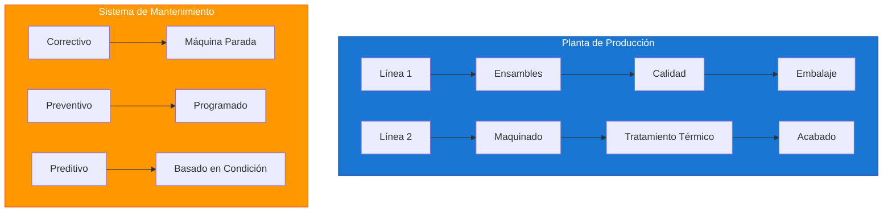
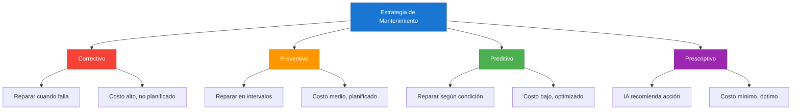
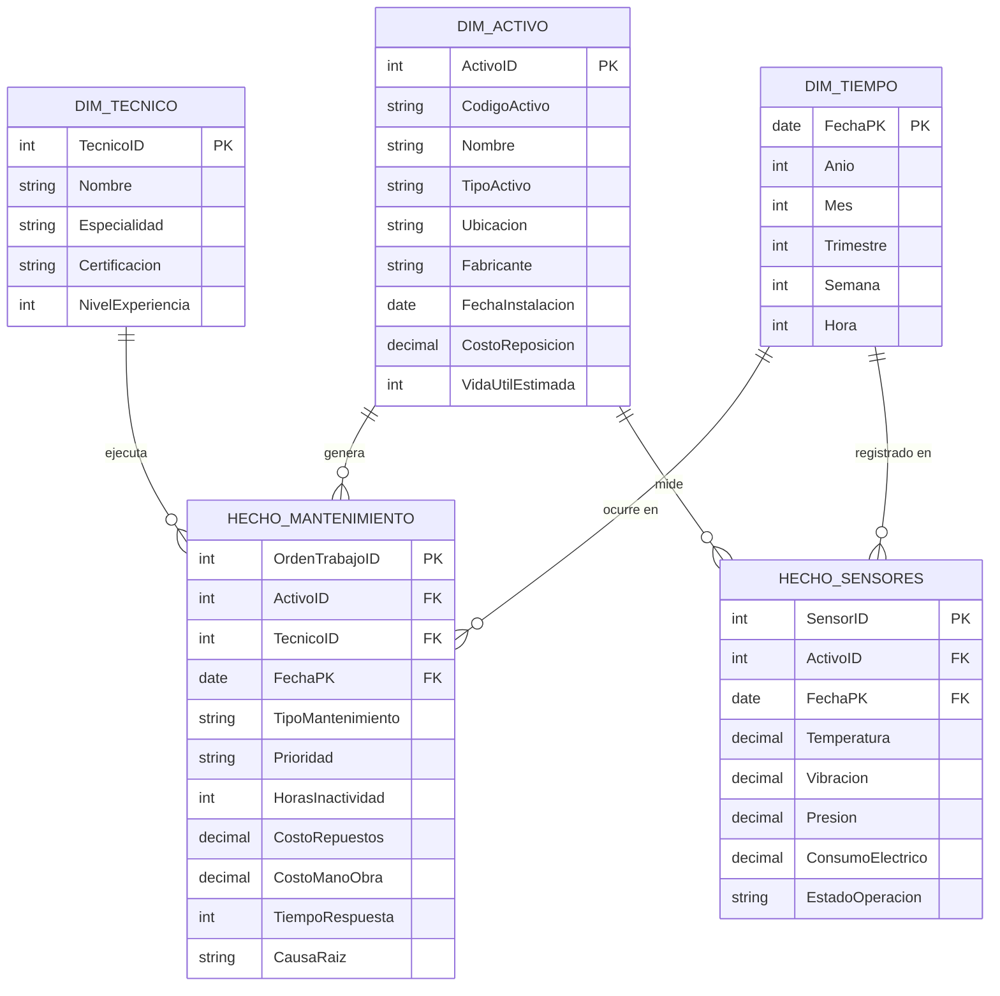

# Caso de Estudio: Mantenimiento Industrial

## Resumen Ejecutivo

| Campo | Detalle |
|-------|---------|
| **Industria** | Manufactura / Producción |
| **Objetivo** | Optimizar mantenimiento y reducir tiempos de inactividad |
| **Datos** | 3 años de registros de mantenimiento, 150 activos, 50 técnicos |
| **Herramientas** | Power BI + Azure IoT Hub + SQL Server |
| **Nivel** | Avanzado |
| **Tiempo estimado** | 8 horas |

---

## Contexto del Negocio

### Empresa Ficticia: ManufuraPro S.A.



- **Sector:** Manufactura automotriz
- **Empleados:** 1,200 personas
- **Planta:** 25,000 m²
- **Activos industriales:** 150 equipos críticos
- **Líneas de producción:** 4 líneas
- **Turnos:** 3 turnos (24/7)

### Problemas Críticos

| Problema | Impacto | Costo Estimado |
|----------|---------|:--------------:|
| Paradas no programadas | Pérdida de producción | $3.5M/año |
| Mantenimiento excesivo | Costos innecesarios | $1.2M/año |
| Falta de repuestos | Demora en reparaciones | $800K/año |
| Sin datos de condición | Decisiones reactivas | $600K/año |
| Vida útil desconocida | Reemplazos prematuros | $400K/año |

---

## Estrategia de Mantenimiento



---

## Modelo de Datos

### Diagrama Entidad-Relación



---

## Métricas Clave (KPIs)

### Tablero de Mantenimiento

| KPI | Fórmula DAX | Meta | Descripción |
|-----|-------------|:----:|-------------|
| **OEE** | `Disponibilidad x Rendimiento x Calidad` | >85% | Overall Equipment Effectiveness |
| **MTBF** | `Tiempo Total / # Fallas` | >720 h | Mean Time Between Failures |
| **MTTR** | `SUM(TiempoReparación) / # Reparaciones` | <4 h | Mean Time To Repair |
| **Disponibilidad** | `TiempoOperación / TiempoTotal` | >95% | % tiempo disponible |
| **Costo Mant./Activo** | `SUM(Costos) / # Activos` | <$25K | Costo promedio por activo |
| **Cumplimiento Prev.** | `Prev.Ejecutados / Prev.Programados` | >90% | % mantenimiento preventivo |

### Medidas DAX Principales

```dax
// 1. OEE (Overall Equipment Effectiveness)
OEE = 
VAR Disponibilidad = 
    VAR TiempoOperacion = SUM(HechoMantenimiento[HorasOperacion])
    VAR TiempoTotal = 24 * COUNTROWS(DISTINCT(DimTiempo[FechaPK]))
    RETURN DIVIDE(TiempoOperacion, TiempoTotal, 0)

VAR Rendimiento = 
    VAR ProduccionReal = SUM(HechoProduccion[CantidadProducida])
    var ProduccionIdeal = SUM(HechoProduccion[CantidadIdeal])
    RETURN DIVIDE(ProduccionReal, ProduccionIdeal, 0)

VAR Calidad = 
    var UnidadesBuenas = SUM(HechoProduccion[UnidadesBuenas])
    var UnidadesTotales = SUM(HechoProduccion[CantidadProducida])
    RETURN DIVIDE(UnidadesBuenas, UnidadesTotales, 0)

RETURN
    Disponibilidad * Rendimiento * Calidad

// 2. MTBF (Mean Time Between Failures)
MTBF = 
VAR TotalHorasOperacion = SUM(HechoMantenimiento[HorasOperacion])
VAR NumeroFallas = 
    CALCULATE(
        COUNTROWS(HechoMantenimiento),
        HechoMantenimiento[TipoMantenimiento] = "Correctivo"
    )
RETURN
    DIVIDE(TotalHorasOperacion, NumeroFallas, 0)

// 3. MTTR (Mean Time To Repair)
MTTR = 
VAR TiempoTotalReparacion = 
    CALCULATE(
        SUM(HechoMantenimiento[HorasInactividad]),
        HechoMantenimiento[TipoMantenimiento] = "Correctivo"
    )
VAR NumeroReparaciones = 
    CALCULATE(
        COUNTROWS(HechoMantenimiento),
        HechoMantenimiento[TipoMantenimiento] = "Correctivo"
    )
RETURN
    DIVIDE(TiempoTotalReparacion, NumeroReparaciones, 0)

// 4. Disponibilidad del Activo
Disponibilidad = 
VAR TiempoOperacion = 
    CALCULATE(
        SUM(HechoMantenimiento[HorasOperacion]),
        ALL(HechoMantenimiento[TipoMantenimiento])
    )
VAR TiempoTotal = 
    DISTINCTCOUNT(DimTiempo[FechaPK]) * 24
RETURN
    DIVIDE(TiempoOperacion, TiempoTotal, 0)

// 5. Costo Total de Mantenimiento
Costo Total Mantenimiento = 
VAR CostoRepuestos = SUM(HechoMantenimiento[CostoRepuestos])
VAR CostoManoObra = SUM(HechoMantenimiento[CostoManoObra])
VAR CostoExternos = SUM(HechoMantenimiento[CostoExternos])
RETURN
    CostoRepuestos + CostoManoObra + CostoExternos

// 6. Clasificación de Activos por Criticidad
Criticidad Activo = 
VAR CostoFalla = 
    CALCULATE(
        SUM(HechoMantenimiento[CostoRepuestos] + HechoMantenimiento[CostoManoObra]),
        ALLEXCEPT(HechoMantenimiento, HechoMantenimiento[ActivoID])
    )
VAR FrecuenciaFallas = 
    CALCULATE(
        COUNTROWS(HechoMantenimiento),
        HechoMantenimiento[TipoMantenimiento] = "Correctivo",
        ALLEXCEPT(HechoMantenimiento, HechoMantenimiento[ActivoID])
    )
VAR Score = CostoFalla * FrecuenciaFallas
RETURN
    SWITCH(
        TRUE(),
        Score > 100000, "Crítico",
        Score > 50000, "Alto",
        Score > 10000, "Medio",
        "Bajo"
    )
```

---

## Dashboard Principal

### Diseño de Página: Vista General

```text
┌─────────────────────────────────────────────────────────────────┐
│  🏭 Panel de Mantenimiento Industrial      [Filtros]           │
├─────────────────┬─────────────────┬─────────────────┬───────────┤
│  ⚙️ OEE         │  ⏱️ MTBF        │  🔧 MTTR        │ 📊 Disp.  │
│   87.3%         │   845 h         │   3.2 h         │  96.8%    │
│   ▲ 2.1pp      │   ▲ 120 h      │   ▼ 0.8 h      │  ▲ 1.2pp │
├─────────────────┴─────────────────┴─────────────────┴───────────┤
│                                                                 │
│  ┌─────────────────────┐  ┌─────────────────────┐              │
│  │   Gráfico de Líneas │  │   Gráfico de Barras │              │
│  │   OEE por Línea     │  │   Fallas por Tipo   │              │
│  └─────────────────────┘  └─────────────────────┘              │
│                                                                 │
│  ┌─────────────────────┐  ┌─────────────────────┐              │
│  │   Gauge Chart       │  │   Treemap           │              │
│  │   Costo vs Presup.  │  │   Activos Críticos  │              │
│  └─────────────────────┘  └─────────────────────┘              │
│                                                                 │
│  ┌─────────────────────────────────────────────────────────┐   │
│  │  📋 Órdenes de Trabajo Abiertas                         │   │
│  │  OT | Activo | Tipo | Prioridad | Técnico | Estado     │   │
│  └─────────────────────────────────────────────────────────┘   │
└─────────────────────────────────────────────────────────────────┘
```

### Página 2: Análisis de Activos

```text
┌─────────────────────────────────────────────────────────────────┐
│  ⚙️ Análisis de Activos y Condición                           │
├─────────────────────────────────────────────────────────────────┤
│                                                                 │
│  ┌─────────────────────┐  ┌─────────────────────┐              │
│  │   Scatter Plot      │  │   Bubble Chart      │              │
│  │   MTBF vs MTTR      │  │   Costo vs Edad     │              │
│  └─────────────────────┘  └─────────────────────┘              │
│                                                                 │
│  ┌─────────────────────────────────────────────────────────┐   │
│  │  📡 Lecturas de Sensores en Tiempo Real                 │   │
│  │  Activo | Temp | Vibración | Presión | Estado          │   │
│  └─────────────────────────────────────────────────────────┘   │
└─────────────────────────────────────────────────────────────────┘
```

### Página 3: Mantenimiento Predictivo

```text
┌─────────────────────────────────────────────────────────────────┐
│  🔮 Mantenimiento Predictivo                                   │
├─────────────────────────────────────────────────────────────────┤
│                                                                 │
│  ┌─────────────────────┐  ┌─────────────────────┐              │
│  │   Forecast Chart    │  │   Anomaly Detection │              │
│  │   Predicción Fallas │  │   Sensores          │              │
│  └─────────────────────┘  └─────────────────────┘              │
│                                                                 │
│  ┌─────────────────────────────────────────────────────────┐   │
│  │  ⚠️ Alertas de Mantenimiento Predictivo                 │   │
│  │  🔴 Alto: 3 activos con probabilidad >80% de falla      │   │
│  │  🟡 Medio: 8 activos entre 50-80% probabilidad          │   │
│  │  🟢 Bajo: 139 activos con probabilidad <50%             │   │
│  └─────────────────────────────────────────────────────────┘   │
└─────────────────────────────────────────────────────────────────┘
```

---

## Mantenimiento Predictivo con Sensores IoT

```dax
// 1. Probabilidad de Falla (basado en sensores)
Probabilidad Falla = 
VAR TempActual = 
    CALCULATE(
        AVERAGE(HechoSensores[Temperatura]),
        LASTNONBLANK(HechoSensores[FechaPK], 1)
    )
VAR VibracionActual = 
    CALCULATE(
        AVERAGE(HechoSensores[Vibracion]),
        LASTNONBLANK(HechoSensores[FechaPK], 1)
    )
VAR TempNormal = 75  // Temperatura normal de operación
VAR VibracionNormal = 2.5  // Vibración normal

VAR DesviacionTemp = ABS(TempActual - TempNormal) / TempNormal
VAR DesviacionVibracion = ABS(VibracionActual - VibracionNormal) / VibracionNormal

VAR ScoreCondicion = (DesviacionTemp * 0.6) + (DesviacionVibracion * 0.4)

RETURN
    SWITCH(
        TRUE(),
        ScoreCondicion > 0.3, "🔴 Alta",
        ScoreCondicion > 0.15, "🟡 Media",
        "🟢 Baja"
    )

// 2. Días hasta próximo mantenimiento preventivo
Días Hasta Preventivo = 
VAR UltimoMantenimiento = 
    CALCULATE(
        MAX(HechoMantenimiento[FechaOrden]),
        HechoMantenimiento[TipoMantenimiento] = "Preventivo"
    )
VAR IntervaloPreventivo = 
    LOOKUPVALUE(
        DIM_ACTIVO[IntervaloPreventivoDias],
        DIM_ACTIVO[ActivoID], MAX(HechoMantenimiento[ActivoID])
    )
VAR ProximoMantenimiento = UltimoMantenimiento + IntervaloPreventivo
RETURN
    DATEDIFF(TODAY(), ProximoMantenimiento, DAY)

// 3. Costo de no mantener (Cost of Downtime)
Costo Inactividad = 
VAR HorasInactividad = SUM(HechoMantenimiento[HorasInactividad])
VAR CostoPorHora = 
    LOOKUPVALUE(
        DIM_ACTIVO[CostoInactividadPorHora],
        DIM_ACTIVO[ActivoID], MAX(HechoMantenimiento[ActivoID])
    )
RETURN
    HorasInactividad * CostoPorHora
```

---

## Vida Útil y Reemplazo

```dax
// Vida Útil Restante
Vida Útil Restante = 
VAR FechaInstalacion = LOOKUPVALUE(DIM_ACTIVO[FechaInstalacion], 
    DIM_ACTIVO[ActivoID], MAX(HechoMantenimiento[ActivoID]))
VAR VidaUtilEstimada = LOOKUPVALUE(DIM_ACTIVO[VidaUtilEstimada], 
    DIM_ACTIVO[ActivoID], MAX(HechoMantenimiento[ActivoID]))
VAR EdadActivo = DATEDIFF(FechaInstalacion, TODAY(), DAY) / 365.25
RETURN
    VidaUtilEstimada - EdadActivo

// Estado de Vida Útil
Estado Vida Útil = 
VAR VidaRestante = [Vida Útil Restante]
RETURN
    SWITCH(
        TRUE(),
        VidaRestante <= 0, "🔴 Reemplazar",
        VidaRestante <= 1, "🟡 Planificar Reemplazo",
        "🟢 Operativo"
    )
```

---

## Lecciones Aprendidas

| Lección | Aplicación |
|---------|------------|
| El OEE es el KPI maestro | Medir Disponibilidad x Rendimiento x Calidad |
| MTBF y MTTR son complementarios | Alto MTBF + bajo MTTR = óptimo |
| Los sensores IoT son el futuro | Invertir en infraestructura de datos |
| El mantenimiento predictivo ahorra | Reducir paradas no programadas |
| La criticidad guía la inversión | Enfocar recursos en activos críticos |

---

## Archivos del Caso de Estudio

```
Mantenimiento_Industrial/
├── README.md                    ← Este archivo
├── data/
│   ├── dim_activo.csv
│   ├── dim_tecnico.csv
│   ├── dim_tiempo.csv
│   ├── hecho_mantenimiento.csv
│   └── hecho_sensores.csv
├── dax/
│   ├── medidas_mantenimiento.dax
│   ├── medidas_predictivo.dax
│   └── calculos_oee.dax
└── report/
    └── dashboard_spec.md
```

---

## Prerrequisitos

- Completar Módulos 00-06
- Conocimientos básicos de mantenimiento industrial (deseable)
