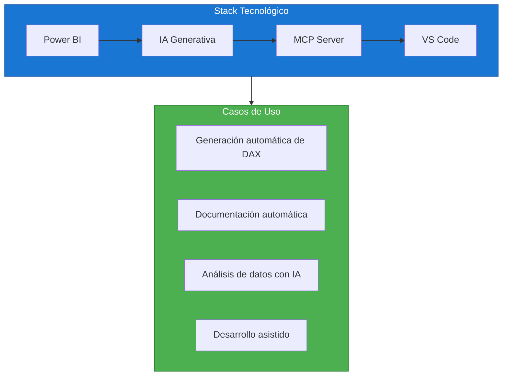
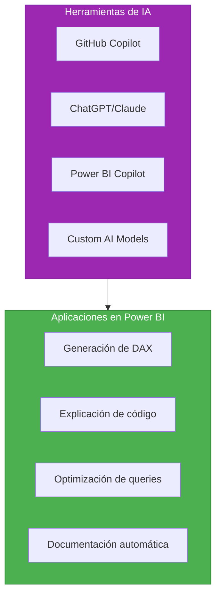
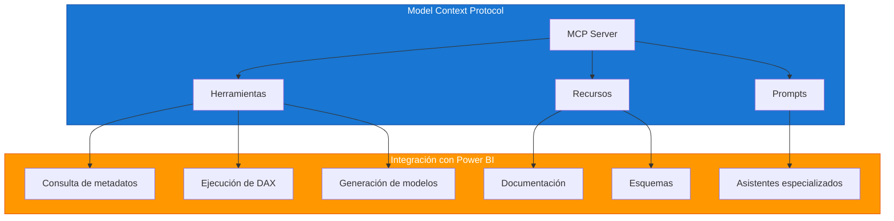
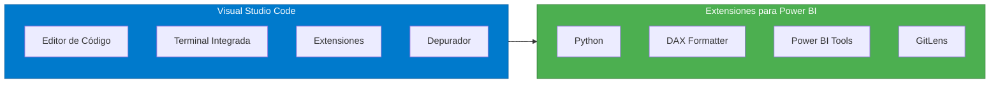
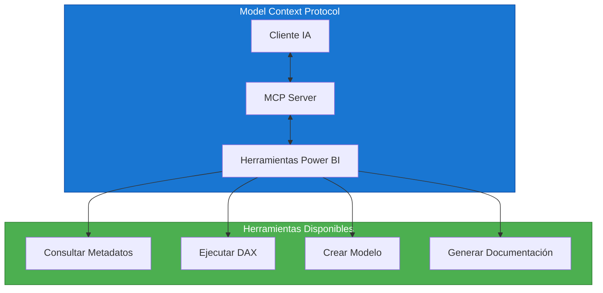
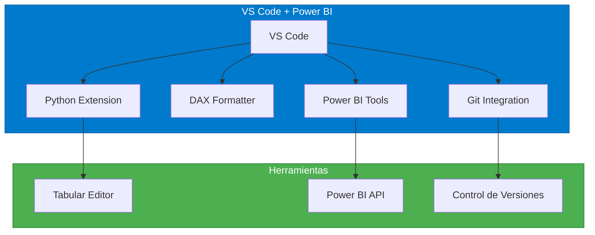
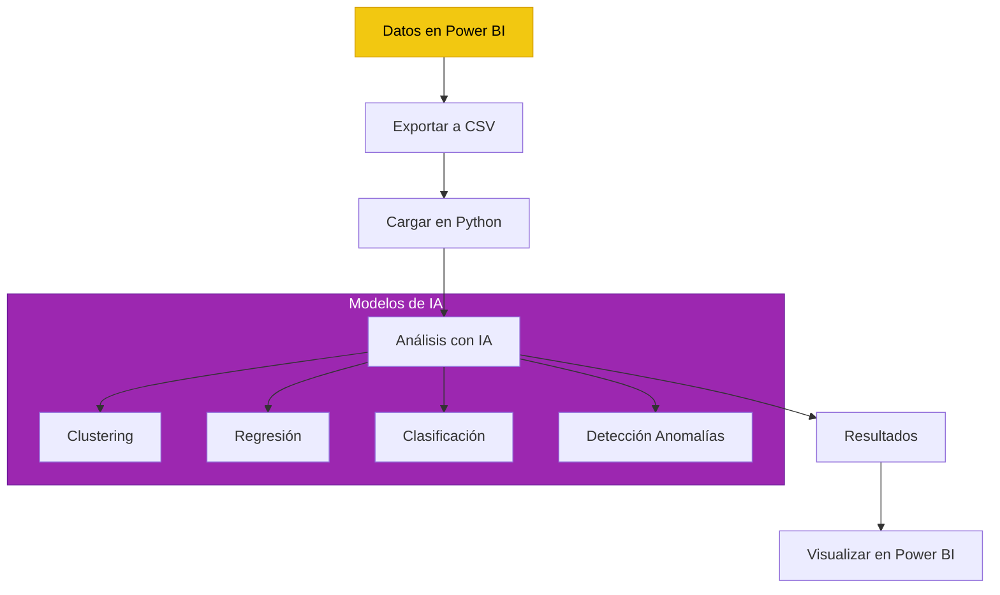
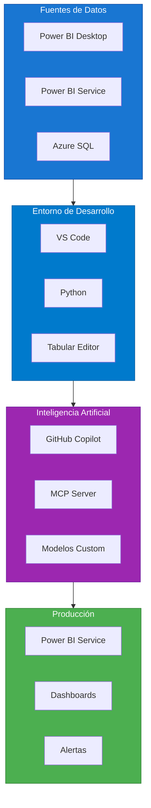

# Caso de Estudio: Power BI con IA, MCP y VS Code

## Resumen Ejecutivo

| Campo | Detalle |
|-------|---------|
| **Tecnología** | Power BI + Inteligencia Artificial + MCP + VS Code |
| **Objetivo** | Integrar IA generativa en flujos de trabajo de Power BI |
| **Herramientas** | Power BI, GitHub Copilot, MCP Server, VS Code, Python |
| **Nivel** | Avanzado-Experto |
| **Tiempo estimado** | 10 horas |

---

## ¿Qué es este caso de estudio?



Este caso de estudio explora cómo las herramientas de IA modernas pueden potenciar tu productividad con Power BI, desde la generación automática de código hasta el análisis inteligente de datos.

---

## Componentes del Stack

### 1. Power BI + DAX


### 2. Inteligencia Artificial Generativa



### 3. MCP (Model Context Protocol)



### 4. VS Code como IDE



---

## Casos de Uso Prácticos

### Caso 1: Generación Automática de DAX con IA

#### Problema
Crear 50 medidas DAX para un modelo de ventas toma horas de trabajo manual.

#### Solución con IA

```python
# Prompt para generar medidas DAX
"""
Eres un experto en DAX para Power BI. Genera las siguientes medidas
para un modelo de ventas con las siguientes tablas:

Tablas:
- HechoVentas (MontoTotal, Cantidad, Descuento, FechaFK, ProductoFK, ClienteFK)
- DimProducto (ProductoID, Nombre, Categoria, SubCategoria)
- DimCliente (ClienteID, Nombre, TipoCliente, Ciudad)
- DimTiempo (FechaPK, Anio, Mes, Trimestre, NombreMes)

Genera las siguientes medidas con comentarios explicativos:
1. Ventas Totales
2. Ventas Netas (con descuento)
3. Margen de Ganancia
4. Ticket Promedio
5. Ventas por Categoría
6. Crecimiento Mes a Mes
7. Ventas Acumuladas del Año (YTD)
8. Comparativa con Año Anterior (PY)
9. Top 5 Productos por Ventas
10. % Participación por Cliente
"""
```

#### Código Generado por IA

```dax
// ============================================
// MEDIDA 1: Ventas Totales
// ============================================
// Propósito: Suma el monto total de todas las ventas
// Autor: Generado por IA
// Fecha: 2026-09-18
// ============================================

Ventas Totales = 
SUM(HechoVentas[MontoTotal])


// ============================================
// MEDIDA 2: Ventas Netas
// ============================================
// Propósito: Ventas totales menos descuentos
// Fórmula: Ventas Totales - Total Descuentos
// ============================================

Ventas Netas = 
VAR VentasBrutas = [Ventas Totales]
VAR TotalDescuentos = SUM(HechoVentas[Descuento])
RETURN
    VentasBrutas - TotalDescuentos


// ============================================
// MEDIDA 3: Margen de Ganancia
// ============================================
// Propósito: Porcentaje de ganancia sobre ventas
// Fórmula: (Ventas - Costo) / Ventas
// ============================================

Margen Ganancia = 
VAR Ventas = [Ventas Netas]
VAR Costo = SUM(HechoVentas[CostoTotal])
VAR Ganancia = Ventas - Costo
RETURN
    DIVIDE(Ganancia, Ventas, 0)


// ============================================
// MEDIDA 4: Ticket Promedio
// ============================================
// Propósito: Gasto promedio por cliente
// Fórmula: Ventas Netas / Clientes Únicos
// ============================================

Ticket Promedio = 
VAR Ventas = [Ventas Netas]
VAR Clientes = DISTINCTCOUNT(HechoVentas[ClienteFK])
RETURN
    DIVIDE(Ventas, Clientes, 0)


// ============================================
// MEDIDA 5: Ventas por Categoría
// ============================================
// Propósito: Ventas agrupadas por categoría de producto
// ============================================

Ventas por Categoría = 
SUMX(
    VALUES(DimProducto[Categoria]),
    [Ventas Netas]
)


// ============================================
// MEDIDA 6: Crecimiento Mes a Mes
// ============================================
// Propósito: Variación porcentual vs mes anterior
// Fórmula: (Mes Actual - Mes Anterior) / Mes Anterior
// ============================================

Crecimiento Mes a Mes = 
VAR VentasActuales = [Ventas Netas]
VAR VentasMesAnterior = 
    CALCULATE(
        [Ventas Netas],
        DATEADD(DimTiempo[FechaPK], -1, MONTH)
    )
RETURN
    DIVIDE(VentasActuales - VentasMesAnterior, VentasMesAnterior, 0)


// ============================================
// MEDIDA 7: Ventas Acumuladas del Año (YTD)
// ============================================
// Propósito: Acumulado de ventas desde inicio del año
// ============================================

Ventas YTD = 
TOTALYTD(
    [Ventas Netas],
    DimTiempo[FechaPK]
)


// ============================================
// MEDIDA 8: Comparativa con Año Anterior (PY)
// ============================================
// Propósito: Ventas del mismo período del año anterior
// ============================================

Ventas PY = 
CALCULATE(
    [Ventas Netas],
    SAMEPERIODLASTYEAR(DimTiempo[FechaPK])
)


// ============================================
// MEDIDA 9: Crecimiento YoY
// ============================================
// Propósito: Variación porcentual interanual
// ============================================

Crecimiento YoY = 
VAR VentasActuales = [Ventas Netas]
VAR VentasAnteriores = [Ventas PY]
RETURN
    DIVIDE(VentasActuales - VentasAnteriores, VentasAnteriores, 0)


// ============================================
// MEDIDA 10: Top 5 Productos por Ventas
// ============================================
// Propósito: Ranking de los 5 productos más vendidos
// ============================================

Top 5 Productos = 
VAR TopProductos = 
    TOPN(
        5,
        VALUES(DimProducto[Nombre]),
        [Ventas Netas],
        DESC
    )
RETURN
    CONCATENATEX(
        TopProductos,
        DimProducto[Nombre] & ": " & FORMAT([Ventas Netas], "#,##0"),
        " | "
    )


// ============================================
// MEDIDA 11: % Participación por Cliente
// ============================================
// Propósito: Porcentaje de ventas de cada cliente sobre el total
// ============================================

% Participación Cliente = 
VAR VentasCliente = [Ventas Netas]
VAR VentasTotal = CALCULATE([Ventas Netas], ALL(HechoVentas[ClienteFK]))
RETURN
    DIVIDE(VentasCliente, VentasTotal, 0)
```

---

### Caso 2: MCP Server para Power BI

#### ¿Qué es MCP?



#### Implementación del MCP Server

```python
# mcp_server_powerbi.py
"""
Servidor MCP para integración de Power BI con IA.
Permite a los asistentes de IA consultar y manipular modelos Power BI.
"""

from mcp import MCP Server, Tool, Resource
import pandas as pd
from typing import Any

# Crear instancia del servidor
server = MCP Server("powerbi-server")

@server.tool()
def query_dax(model_path: str, dax_query: str) -> dict:
    """
    Ejecuta una consulta DAX contra un modelo Power BI.
    
    Args:
        model_path: Ruta al archivo .pbix o .bim
        dax_query: Consulta DAX a ejecutar
    
    Returns:
        Resultado de la consulta en formato DataFrame
    """
    # Implementación de conexión al modelo
    # Using Tabular Object Model (TOM)
    import clr
    clr.AddReference('Microsoft.AnalysisServices.Tabular')
    from Microsoft.AnalysisServices.Tabular import Server
    
    server = Server()
    server.Connect(model_path)
    
    # Ejecutar consulta
    results = server.DAXQuery(dax_query)
    
    return {
        "columns": list(results.columns),
        "data": results.to_dict('records'),
        "row_count": len(results)
    }

@server.tool()
def get_model_metadata(model_path: str) -> dict:
    """
    Obtiene los metadatos del modelo Power BI.
    
    Returns:
        Estructura completa del modelo (tablas, columnas, relaciones, medidas)
    """
    # Obtener metadatos del modelo
    metadata = {
        "tables": [],
        "relationships": [],
        "measures": []
    }
    
    # Lógica para extraer metadatos
    # ...
    
    return metadata

@server.tool()
def generate_dax_measure(
    table_name: str,
    measure_name: str,
    description: str,
    existing_measures: list
) -> str:
    """
    Genera una medida DAX basada en una descripción en lenguaje natural.
    
    Args:
        table_name: Nombre de la tabla objetivo
        measure_name: Nombre de la medida
        description: Descripción de lo que debe calcular
        existing_measures: Lista de medidas existentes para contexto
    
    Returns:
        Código DAX generado
    """
    # Usar IA para generar DAX
    prompt = f"""
    Genera una medida DAX llamada {measure_name} para la tabla {table_name}.
    
    Descripción: {description}
    
    Medidas existentes para contexto:
    {chr(10).join(existing_measures)}
    
    Genera solo el código DAX con comentarios explicativos.
    """
    
    # Llamar a la API de IA (OpenAI, Claude, etc.)
    # generated_dax = call_ai_api(prompt)
    
    return "generated_dax"

@server.resource("powerbi://model/schema")
def get_schema_resource() -> str:
    """
    Recurso que expone el esquema del modelo para que la IA lo consulte.
    """
    # Obtener esquema del modelo activo
    schema = get_model_metadata(current_model_path)
    return json.dumps(schema, indent=2)

@server.prompt()
def analyze_model_prompt(model_info: dict) -> str:
    """
    Prompt predefinido para analizar un modelo Power BI.
    """
    return f"""
    Eres un experto en Power BI y DAX. Analiza el siguiente modelo de datos:
    
    Tablas: {model_info['tables']}
    Relaciones: {model_info['relationships']}
    Medidas: {model_info['measures']}
    
    Proporciona:
    1. Evaluación de la estructura del modelo
    2. Recomendaciones de optimización
    3. Medidas faltantes sugeridas
    4. Problemas potenciales de rendimiento
    """

if __name__ == "__main__":
    server.run()
```

---

### Caso 3: Desarrollo en VS Code con Power BI

#### Configuración del Entorno



#### Script de Automatización

```python
# powerbi_automation.py
"""
Script de automatización para Power BI usando Python y VS Code.
Permite crear, modificar y desplegar modelos Power BI programáticamente.
"""

import json
import os
from pathlib import Path
from typing import List, Dict, Any

class PowerBIAutomation:
    """Clase principal para automatización de Power BI."""
    
    def __init__(self, model_path: str):
        self.model_path = model_path
        self.model = self._load_model()
    
    def _load_model(self) -> Dict:
        """Carga el modelo desde el archivo .bim"""
        with open(self.model_path, 'r', encoding='utf-8') as f:
            return json.load(f)
    
    def add_measure(
        self,
        table_name: str,
        measure_name: str,
        expression: str,
        format_string: str = None
    ) -> bool:
        """
        Agrega una medida al modelo.
        
        Args:
            table_name: Nombre de la tabla
            measure_name: Nombre de la medida
            expression: Expresión DAX
            format_string: Formato de presentación (opcional)
        
        Returns:
            True si se agregó correctamente
        """
        try:
            # Buscar la tabla en el modelo
            for table in self.model['model']['tables']:
                if table['name'] == table_name:
                    # Crear la medida
                    measure = {
                        'name': measure_name,
                        'expression': expression
                    }
                    if format_string:
                        measure['formatString'] = format_string
                    
                    # Agregar a la tabla
                    if 'measures' not in table:
                        table['measures'] = []
                    table['measures'].append(measure)
                    
                    return True
            
            return False
        
        except Exception as e:
            print(f"Error al agregar medida: {e}")
            return False
    
    def generate_documentation(self) -> str:
        """
        Genera documentación del modelo en formato Markdown.
        
        Returns:
            Documentación en Markdown
        """
        doc = "# Documentación del Modelo Power BI\n\n"
        
        # Tablas
        doc += "## Tablas\n\n"
        for table in self.model['model']['tables']:
            doc += f"### {table['name']}\n\n"
            
            # Columnas
            if 'columns' in table:
                doc += "**Columnas:**\n\n"
                doc += "| Nombre | Tipo | Descripción |\n"
                doc += "|--------|------|-------------|\n"
                for col in table['columns']:
                    doc += f"| {col['name']} | {col.get('dataType', 'N/A')} | {col.get('description', 'N/A')} |\n"
                doc += "\n"
            
            # Medidas
            if 'measures' in table:
                doc += "**Medidas:**\n\n"
                for measure in table['measures']:
                    doc += f"- **{measure['name']}**: `{measure['expression']}`\n"
                doc += "\n"
        
        # Relaciones
        if 'relationships' in self.model['model']:
            doc += "## Relaciones\n\n"
            for rel in self.model['model']['relationships']:
                doc += f"- {rel['fromTable']}.{rel['fromColumn']} → {rel['toTable']}.{rel['toColumn']}\n"
        
        return doc
    
    def validate_model(self) -> List[Dict]:
        """
        Valida el modelo en busca de problemas comunes.
        
        Returns:
            Lista de problemas encontrados
        """
        issues = []
        
        # Verificar tablas sin columnas
        for table in self.model['model']['tables']:
            if 'columns' not in table or len(table['columns']) == 0:
                issues.append({
                    'type': 'warning',
                    'table': table['name'],
                    'message': 'Tabla sin columnas definidas'
                })
        
        # Verificar medidas sin expresión
        for table in self.model['model']['tables']:
            if 'measures' in table:
                for measure in table['measures']:
                    if 'expression' not in measure or not measure['expression']:
                        issues.append({
                            'type': 'error',
                            'table': table['name'],
                            'measure': measure['name'],
                            'message': 'Medida sin expresión DAX'
                        })
        
        return issues
    
    def export_to_tmdl(self, output_path: str) -> bool:
        """
        Exporta el modelo a formato TMDL.
        
        Args:
            output_path: Ruta de salida para el archivo .tmdl
        
        Returns:
            True si se exportó correctamente
        """
        try:
            # Generar contenido TMDL
            tmdl_content = self._generate_tmdl()
            
            # Guardar archivo
            with open(output_path, 'w', encoding='utf-8') as f:
                f.write(tmdl_content)
            
            return True
        
        except Exception as e:
            print(f"Error al exportar TMDL: {e}")
            return False
    
    def _generate_tmdl(self) -> str:
        """Genera el contenido en formato TMDL."""
        tmdl = "// Modelo Power BI - Generado automáticamente\n\n"
        
        for table in self.model['model']['tables']:
            tmdl += f"table {table['name']}\n"
            
            if 'columns' in table:
                for col in table['columns']:
                    tmdl += f"    column {col['name']}\n"
                    tmdl += f"        dataType: {col.get('dataType', 'string')}\n"
            
            if 'measures' in table:
                for measure in table['measures']:
                    tmdl += f"    measure {measure['name']}\n"
                    tmdl += f"        expression: {measure['expression']}\n"
            
            tmdl += "\n"
        
        return tmdl


# Ejemplo de uso
if __name__ == "__main__":
    # Crear instancia de automatización
    pb = PowerBIAutomation("modelo.pbim")
    
    # Agregar medidas
    pb.add_measure(
        "HechoVentas",
        "Ventas Totales",
        "SUM(HechoVentas[MontoTotal])",
        "#,##0.00 €"
    )
    
    # Generar documentación
    doc = pb.generate_documentation()
    with open("documentacion.md", "w", encoding="utf-8") as f:
        f.write(doc)
    
    # Validar modelo
    issues = pb.validate_model()
    if issues:
        print("Problemas encontrados:")
        for issue in issues:
            print(f"  - {issue['type']}: {issue['message']}")
```

---

### Caso 4: Análisis de Datos con IA

#### Pipeline de Análisis



#### Script de Análisis

```python
# ai_analysis.py
"""
Análisis de datos de Power BI usando modelos de IA.
"""

import pandas as pd
import numpy as np
from sklearn.cluster import KMeans
from sklearn.ensemble import RandomForestClassifier
from sklearn.preprocessing import StandardScaler
import matplotlib.pyplot as plt
import seaborn as sns

class PowerBIAnalyzer:
    """Analizador de datos de Power BI con IA."""
    
    def __init__(self, data_path: str):
        self.data = pd.read_csv(data_path)
        self.scaler = StandardScaler()
    
    def customer_segmentation(self, n_clusters: int = 4) -> pd.DataFrame:
        """
        Segmenta clientes usando K-Means.
        
        Args:
            n_clusters: Número de segmentos
        
        Returns:
            DataFrame con segmentos asignados
        """
        # Seleccionar características
        features = ['MontoTotal', 'CantidadCompras', 'DiasDesdeUltimaCompra']
        X = self.data[features]
        
        # Escalar datos
        X_scaled = self.scaler.fit_transform(X)
        
        # Aplicar K-Means
        kmeans = KMeans(n_clusters=n_clusters, random_state=42)
        self.data['Segmento'] = kmeans.fit_predict(X_scaled)
        
        # Nombrar segmentos
        segment_names = {
            0: 'VIP',
            1: 'Frecuente',
            2: 'Ocasional',
            3: 'Nuevo'
        }
        self.data['NombreSegmento'] = self.data['Segmento'].map(segment_names)
        
        return self.data
    
    def predict_churn(self) -> pd.DataFrame:
        """
        Predice probabilidad de abandono de clientes.
        
        Returns:
            DataFrame con predicciones
        """
        # Features para predicción
        features = [
            'DiasDesdeUltimaCompra',
            'MontoPromedio',
            'FrecuenciaCompras',
            'Quejas'
        ]
        
        X = self.data[features]
        y = self.data['Abandono']  # Variable objetivo
        
        # Entrenar modelo
        model = RandomForestClassifier(n_estimators=100, random_state=42)
        model.fit(X, y)
        
        # Predecir probabilidad
        self.data['ProbabilidadAbandono'] = model.predict_proba(X)[:, 1]
        
        # Clasificar riesgo
        self.data['RiesgoAbandono'] = pd.cut(
            self.data['ProbabilidadAbandono'],
            bins=[0, 0.3, 0.6, 1],
            labels=['Bajo', 'Medio', 'Alto']
        )
        
        return self.data
    
    def anomaly_detection(self, column: str) -> pd.DataFrame:
        """
        Detecta anomalías en una columna específica.
        
        Args:
            column: Nombre de la columna a analizar
        
        Returns:
            DataFrame con anomalías marcadas
        """
        from sklearn.ensemble import IsolationForest
        
        # Preparar datos
        X = self.data[[column]].values
        
        # Aplicar Isolation Forest
        clf = IsolationForest(contamination=0.1, random_state=42)
        self.data['Anomalia'] = clf.fit_predict(X)
        
        # 1 = normal, -1 = anomalía
        self.data['EsAnomalia'] = self.data['Anomalia'] == -1
        
        return self.data
    
    def generate_insights(self) -> str:
        """
        Genera insights automáticos del análisis.
        
        Returns:
            Texto con insights
        """
        insights = []
        
        # Resumen estadístico
        insights.append("## Resumen Estadístico\n")
        insights.append(self.data.describe().to_markdown())
        
        # Distribución de segmentos
        if 'Segmento' in self.data.columns:
            insights.append("\n## Distribución de Segmentos\n")
            segment_dist = self.data['Segmento'].value_counts()
            insights.append(segment_dist.to_markdown())
        
        # Anomalías detectadas
        if 'EsAnomalia' in self.data.columns:
            n_anomalies = self.data['EsAnomalia'].sum()
            insights.append(f"\n## Anomalías Detectadas: {n_anomalies}\n")
        
        return "\n".join(insights)
    
    def export_results(self, output_path: str):
        """Exporta resultados a CSV para Power BI."""
        self.data.to_csv(output_path, index=False, encoding='utf-8')
        print(f"Resultados exportados a: {output_path}")


# Ejemplo de uso
if __name__ == "__main__":
    # Cargar datos de Power BI
    analyzer = PowerBIAnalyzer("ventas_powerbi.csv")
    
    # Segmentación de clientes
    analyzer.customer_segmentation(n_clusters=4)
    
    # Predicción de abandono
    analyzer.predict_churn()
    
    # Detección de anomalías en montos
    analyzer.anomaly_detection('MontoTotal')
    
    # Generar insights
    insights = analyzer.generate_insights()
    with open("insights.md", "w", encoding="utf-8") as f:
        f.write(insights)
    
    # Exportar resultados
    analyzer.export_results("resultados_analisis.csv")
    
    print("Análisis completado exitosamente")
```

---

## Arquitectura Completa



---

## Beneficios de esta Integración

| Beneficio | Ahorro Estimado | Descripción |
|-----------|:---------------:|-------------|
| Generación de DAX con IA | 60% del tiempo | De horas a minutos |
| Documentación automática | 80% del tiempo | Siempre actualizada |
| Detección de anomalías | 90% del tiempo | Automatizado |
| Análisis predictivo | 70% del tiempo | Modelos pre-entrenados |
| Control de versiones | 50% del tiempo | Git integration |

---

## Lecciones Aprendidas

| Lección | Aplicación |
|---------|------------|
| La IA es un asistente, no reemplaza | Validar siempre el código generado |
| MCP abre nuevas posibilidades | Integrar IA con herramientas existentes |
| VS Code es potente | Automatizar tareas repetitivas |
| Los datos son el oxygen de la IA | Mantener datos limpios y estructurados |
| La experimentación es clave | Probar nuevas herramientas constantemente |

---

## Archivos del Caso de Estudio

```
PowerBI_IA_MCP/
├── README.md                    ← Este archivo
├── scripts/
│   ├── mcp_server_powerbi.py
│   ├── powerbi_automation.py
│   └── ai_analysis.py
├── examples/
│   ├── dax_generado.txt
│   ├── modelo_ejemplo.bim
│   └── datos_ejemplo.csv
├── docs/
│   ├── guia_mcp.md
│   ├── configuracion_vscode.md
│   └── mejores_practicas.md
└── templates/
    ├── prompt_dax.txt
    └── prompt_modelo.txt
```

---

## Prerrequisitos

- Completar Módulos 00-06
- Conocimientos de Python (deseable)
- VS Code instalado
- Cuenta de GitHub (para Copilot)
