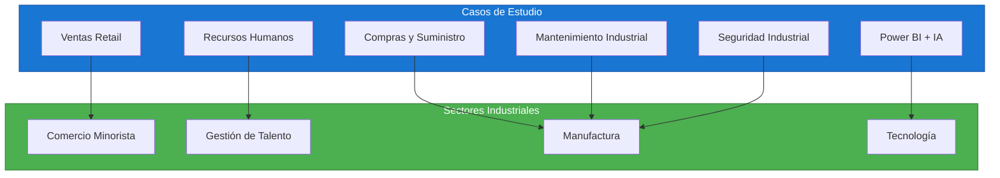
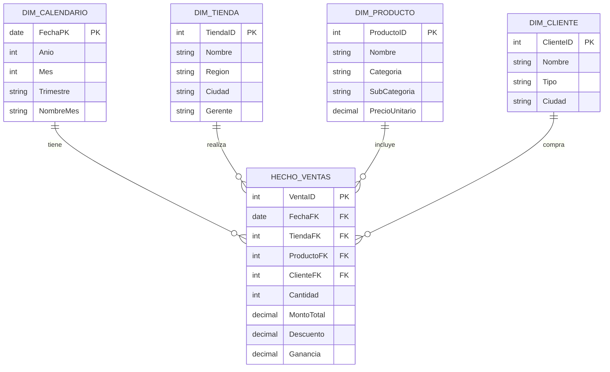
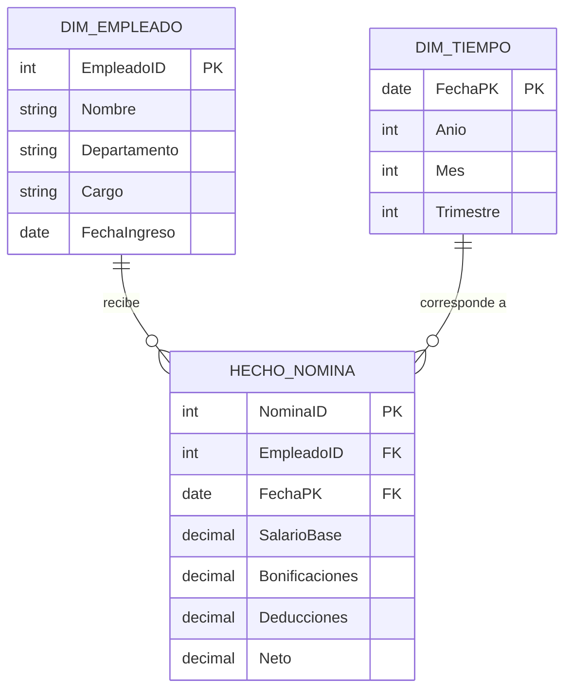
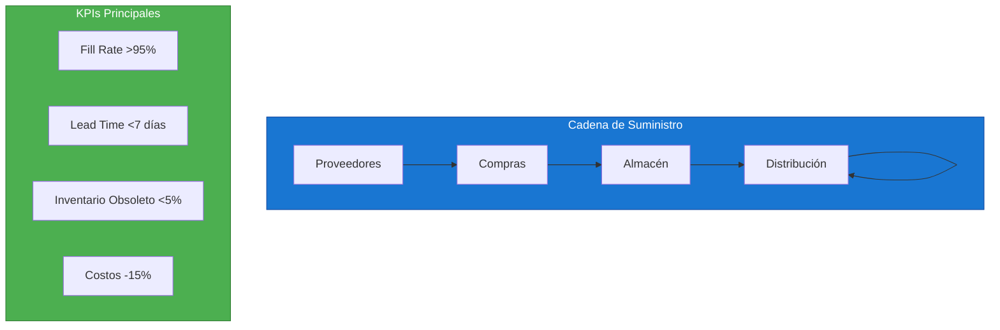
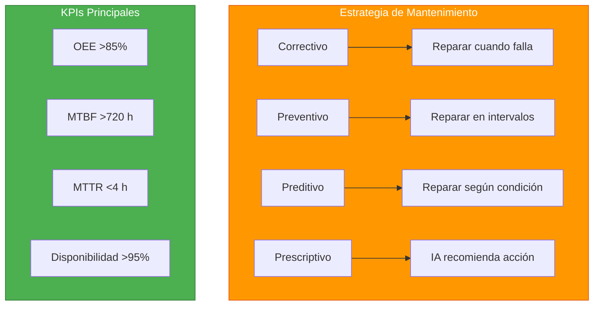
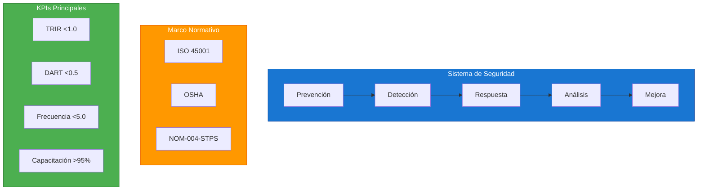
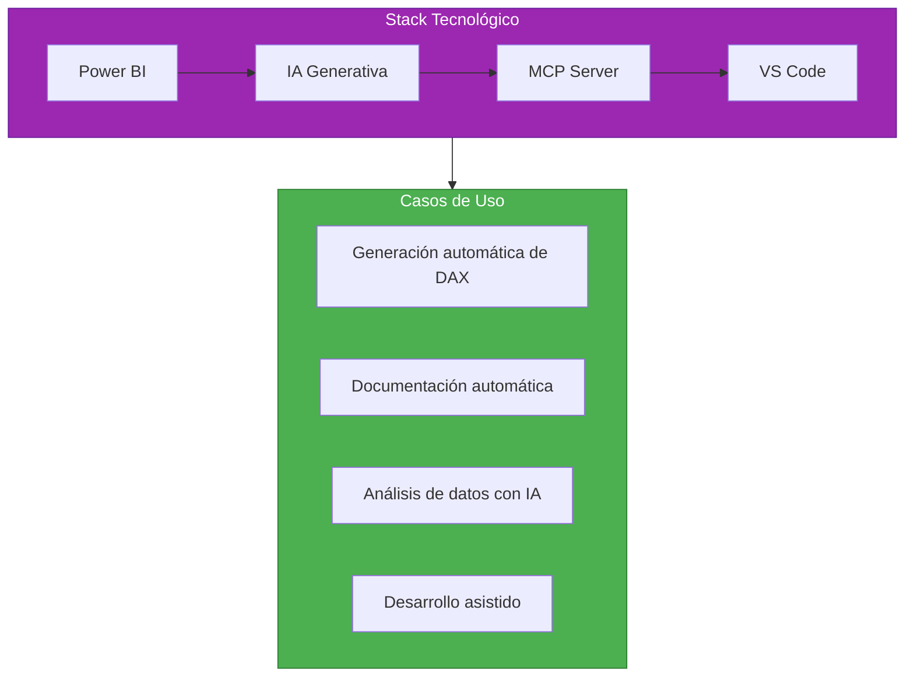

# Módulo 07: Casos de Estudio Completos

## Descripción

Este módulo presenta implementaciones completas de Power BI en escenarios empresariales reales. Cada caso incluye modelo de datos, medidas DAX, diseño de dashboard y lecciones aprendidas.

---

## Casos de Estudio Disponibles

| Caso | Industria | Nivel | Tiempo | Complejidad |
|------|-----------|:-----:|:------:|:-----------:|
| [Ventas Retail](Ventas_Retail/) | Comercio Minorista | Intermedio-Avanzado | 4 h | ⭐⭐⭐ |
| [Recursos Humanos](Recursos_Humanos/) | Gestión de Talento | Intermedio | 3 h | ⭐⭐ |
| [Compras y Cadena de Suministro](Compras_Cadena_Suministro/) | Manufactura / Distribución | Intermedio-Avanzado | 6 h | ⭐⭐⭐⭐ |
| [Mantenimiento Industrial](Mantenimiento_Industrial/) | Manufactura / Producción | Avanzado | 8 h | ⭐⭐⭐⭐⭐ |
| [Seguridad Industrial](Seguridad_Industrial/) | Manufactura / Construcción | Intermedio-Avanzado | 6 h | ⭐⭐⭐⭐ |
| [Power BI + IA + MCP](PowerBI_IA_MCP/) | Tecnología / Desarrollo | Avanzado-Experto | 10 h | ⭐⭐⭐⭐⭐ |

---

## Mapa de Casos por Industria

---

## Caso 1: Ventas Retail

### Métricas Clave

| Métrica | Fórmula DAX | Descripción |
|---------|-------------|-------------|
| Ventas Brutas | `SUM(Hecho[MontoTotal])` | Total de ventas antes de descuentos |
| Ventas Netas | `[Brutas] - SUM(Hecho[Descuento])` | Ventas después de descuentos |
| Margen % | `DIVIDE([Ganancia], [Netas])` | Porcentaje de ganancia |
| Ticket Promedio | `DIVIDE([Netas], Clientes)` | Gasto promedio por cliente |
| Crecimiento YoY | `DIVIDE([Act]-[Ant], [Ant])` | Variación interanual |

---

## Caso 2: Recursos Humanos

### Métricas Clave

| Métrica | Fórmula DAX | Descripción |
|---------|-------------|-------------|
| Nómina Total | `SUM(Nomina[Neto])` | Total de pagos netos |
| Costo por Departamento | `SUM(Nomina[Neto]) GROUP BY Depto` | Gasto por área |
| Rotación de Personal | `ConteoSalidas / PromedioEmpleados` | Tasa de rotación |
| Antigüedad Promedio | `AVG(DATEDIFF(Hoy, Ingreso))` | Años promedio en la empresa |

---

## Caso 3: Compras y Cadena de Suministro

### Métricas Clave

| Métrica | Fórmula DAX | Meta |
|---------|-------------|:----:|
| Fill Rate | `DIVIDE(CantRecibida, CantOrdenada)` | >95% |
| Lead Time Promedio | `AVG(DiasEntrega)` | <7 días |
| Score Proveedor | `Calidad x 0.4 + Tiempo x 0.35 + Costo x 0.25` | >4.0 |
| Días de Stock | `StockActual / ConsumoDiario` | 15-30 días |

---

## Caso 4: Mantenimiento Industrial

### Métricas Clave

| Métrica | Fórmula DAX | Meta |
|---------|-------------|:----:|
| OEE | `Disponibilidad x Rendimiento x Calidad` | >85% |
| MTBF | `TiempoTotal / #Fallas` | >720 h |
| MTTR | `SUM(TiempoReparación) / #Reparaciones` | <4 h |
| Disponibilidad | `TiempoOperación / TiempoTotal` | >95% |

---

## Caso 5: Seguridad Industrial

### Métricas Clave

| Métrica | Fórmula DAX | Meta |
|---------|-------------|:----:|
| TRIR | `(Incidentes x 200K) / HorasTrabajadas` | <1.0 |
| DART | `(DíasPerdidos x 200K) / HorasTrabajadas` | <0.5 |
| Frecuencia | `(Incidentes x 1M) / HorasTrabajadas` | <5.0 |
| Cumplimiento Capacitación | `HorasRealizadas / HorasPlaneadas` | >95% |

---

## Caso 6: Power BI + IA + MCP

### Componentes

| Componente | Función | Herramienta |
|------------|---------|-------------|
| **IA Generativa** | Generar código DAX | GitHub Copilot, ChatGPT |
| **MCP Server** | Integración IA-Power BI | Custom MCP Server |
| **VS Code** | IDE de desarrollo | Visual Studio Code |
| **Python** | Automatización | Scripts personalizados |

---

## Tabla Comparativa de Casos

| Característica | Retail | RRHH | Compras | Mantenimiento | Seguridad | IA+MCP |
|----------------|:------:|:----:|:-------:|:-------------:|:---------:|:------:|
| **Volumen datos** | Medio | Bajo | Alto | Alto | Medio | Variable |
| **Complejidad DAX** | Media | Baja | Alta | Muy Alta | Media | Muy Alta |
| **Modelo dimensional** | Estrella | simple | Estrella | Estrella | Estrella | Flexible |
| **Time Intelligence** | Sí | Sí | Parcial | Sí | Parcial | Sí |
| **IoT/Sensores** | No | No | No | Sí | Sí | No |
| **IA/ML** | No | No | No | Parcial | No | Sí |
| **Costo implementación** | Bajo | Bajo | Medio | Alto | Medio | Variable |

---

## Lecciones Aprendidas

| Lección | Aplicación |
|---------|------------|
| El modelo dimensional es fundamental | Usar esquema estrella siempre que sea posible |
| Las medidas deben ser reutilizables | Crear medidas base y medidas calculadas separadas |
| La granularidad debe ser consistente | Definir la granularidad antes de diseñar el modelo |
| Los datos de ejemplo agilizan el desarrollo | Generar datos de prueba representativos |
| La industria-specific knowledge es clave | Entender el dominio antes de modelar |
| La IA potencia la productividad | Usar herramientas de IA para tareas repetitivas |

---

## Prerrequisitos

- Completar los Módulos 00-06
- Cuenta de Power BI Desktop instalada
- Para Caso 6: Python, VS Code, cuenta GitHub

---

## Siguiente Módulo → [08: Ejercicios DAX](../08_Ejercicios_DAX_Progresivos/)
