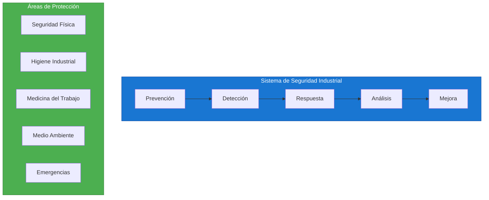
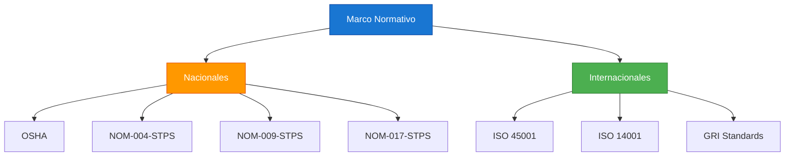
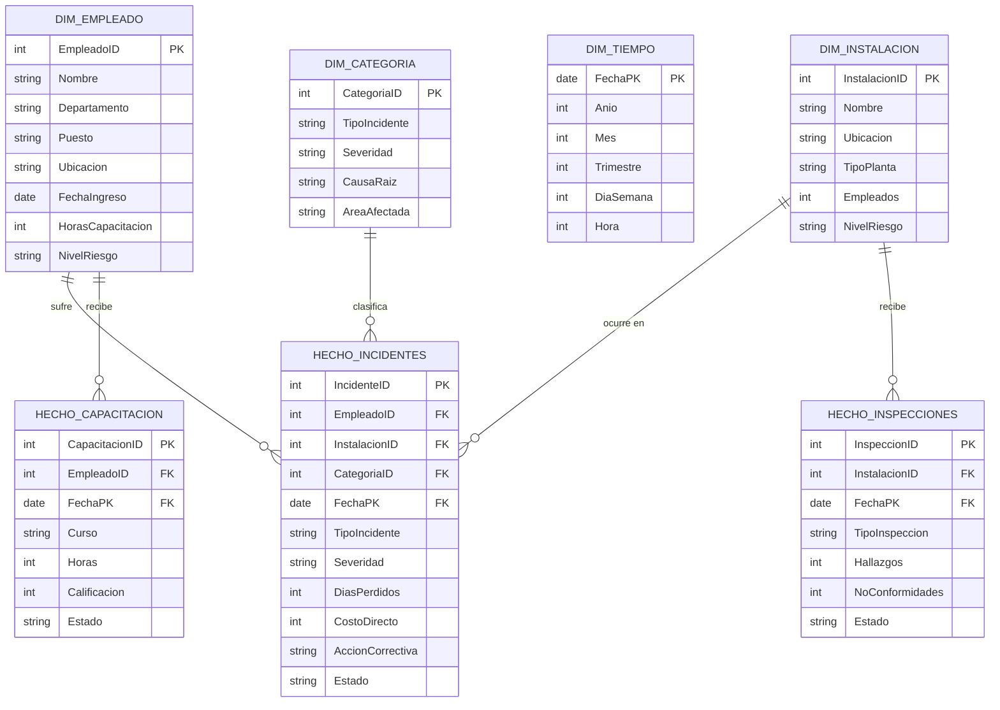

# Caso de Estudio: Seguridad Industrial e Higiene

## Resumen Ejecutivo

| Campo | Detalle |
|-------|---------|
| **Industria** | Manufactura / Construcción / Minería |
| **Objetivo** | Prevenir accidentes y garantizar cumplimiento normativo |
| **Datos** | 5 años de incidentes, 3,000 empleados, 10 plantas |
| **Herramientas** | Power BI + Azure Data Lake + SharePoint |
| **Nivel** | Intermedio-Avanzado |
| **Tiempo estimado** | 6 horas |

---

## Contexto del Negocio

### Empresa Ficticia: SeguridadTotal S.A.



- **Sector:** Manufactura química
- **Empleados:** 3,000 personas
- **Plantas:** 10 ubicaciones (Latinoamérica)
- **Horas-hombre:** 6.5M/año
- **Incidentes anuales:** 150 (objetivo: <50)
- **Días perdidos:** 850 (objetivo: <200)

### Problemas Críticos

| Problema | Impacto | Costo Estimado |
|----------|---------|:--------------:|
| Alta tasa de incidentes | Lesiones y bajas | $4.2M/año |
| Días perdidos por accidentes | Pérdida de productividad | $2.8M/año |
| Multas por incumplimiento | Sanciones regulatorias | $1.5M/año |
| Falta de capacitación | Conductas inseguras | $900K/año |
| Sin datos predictivos | Prevención reactiva | $600K/año |

---

## Marco Normativo



---

## Modelo de Datos

### Diagrama Entidad-Relación



---

## Métricas Clave (KPIs)

### Tablero de Seguridad

| KPI | Fórmula DAX | Meta | Descripción |
|-----|-------------|:----:|-------------|
| **TRIR** | `(Incidentes x 200K) / HorasTrabajadas` | <1.0 | Total Recordable Incident Rate |
| **DART** | `(DíasPerdidos x 200K) / HorasTrabajadas` | <0.5 | Days Away Restricted Transferred |
| **Frecuencia** | `(Incidentes x 1M) / HorasTrabajadas` | <5.0 | Frecuencia de accidentes |
| **Severidad** | `(DíasPerdidos x 1K) / HorasTrabajadas` | <0.3 | Severidad de accidentes |
| **Avance Incidentes** | `Cerrados / Total` | 100% | % incidentes resueltos |
| **Capacitación** | `HorasRealizadas / HorasPlaneadas` | >95% | % cumplimiento capacitación |

### Medidas DAX Principales

```dax
// 1. TRIR (Total Recordable Incident Rate)
TRIR = 
VAR Incidentes = COUNTROWS(HechoIncidentes)
VAR HorasTrabajadas = SUM(HechoCapacitacion[HorasTrabajadas])
VAR Factor = 200000  // 200,000 horas-hombre (estándar)
RETURN
    DIVIDE(Incidentes * Factor, HorasTrabajadas, 0)

// 2. Frecuencia de Accidentes
Frecuencia Accidentes = 
VAR Incidentes = COUNTROWS(HechoIncidentes)
VAR HorasTrabajadas = SUM(HechoCapacitacion[HorasTrabajadas])
VAR Factor = 1000000  // 1 millón de horas-hombre
RETURN
    DIVIDE(Incidentes * Factor, HorasTrabajadas, 0)

// 3. Severidad de Accidentes
Severidad Accidentes = 
VAR DiasPerdidos = SUM(HechoIncidentes[DiasPerdidos])
VAR HorasTrabajadas = SUM(HechoCapacitacion[HorasTrabajadas])
VAR Factor = 1000000
RETURN
    DIVIDE(DiasPerdidos * Factor, HorasTrabajadas, 0)

// 4. Tasa de Lesiones (por 100 empleados)
Tasa Lesiones = 
VAR Lesiones = 
    CALCULATE(
        COUNTROWS(HechoIncidentes),
        HechoIncidentes[TipoIncidente] = "Lesión"
    )
VAR Empleados = DISTINCTCOUNT(DIM_EMPLEADO[EmpleadoID])
RETURN
    DIVIDE(Lesiones * 100, Empleados, 0)

// 5. % Cumplimiento de Capacitación
Cumplimiento Capacitacion = 
VAR HorasRealizadas = 
    CALCULATE(
        SUM(HechoCapacitacion[Horas]),
        HechoCapacitacion[Estado] = "Completado"
    )
VAR HorasPlaneadas = 
    CALCULATE(
        SUM(HechoCapacitacion[Horas]),
        ALL(HechoCapacitacion[Estado])
    )
RETURN
    DIVIDE(HorasRealizadas, HorasPlaneadas, 0)

// 6. Índice de Gravedad
Indice Gravedad = 
VAR DiasPerdidos = SUM(HechoIncidentes[DiasPerdidos])
VAR Incidentes = COUNTROWS(HechoIncidentes)
RETURN
    DIVIDE(DiasPerdidos, Incidentes, 0)

// 7. Costo por Incidente
Costo Por Incidente = 
VAR CostoTotal = SUM(HechoIncidentes[CostoDirecto])
VAR Incidentes = COUNTROWS(HechoIncidentes)
RETURN
    DIVIDE(CostoTotal, Incidentes, 0)

// 8. Probabilidad de Incidente por Departamento
Probabilidad Incidente = 
VAR IncidentesDept = COUNTROWS(HechoIncidentes)
VAR EmpleadosDept = DISTINCTCOUNT(DIM_EMPLEADO[EmpleadoID])
VAR HorasDept = SUM(HechoCapacitacion[HorasTrabajadas])
VAR RiskScore = DIVIDE(IncidentesDept, HorasDept, 0) * EmpleadosDept
RETURN
    SWITCH(
        TRUE(),
        RiskScore > 0.1, "🔴 Alto",
        RiskScore > 0.05, "🟡 Medio",
        "🟢 Bajo"
    )
```

---

## Dashboard Principal

### Diseño de Página: Vista Ejecutiva

```text
┌─────────────────────────────────────────────────────────────────┐
│  🛡️ Panel de Seguridad Industrial         [Filtros]            │
├─────────────────┬─────────────────┬─────────────────┬───────────┤
│  📊 TRIR        │  ⏱️ DART        │  📈 Frecuencia  │ 💰 Costo  │
│   0.85          │   0.32          │   3.2           │  $45K     │
│   ▼ 0.15      │   ▼ 0.08       │   ▼ 1.1        │  ▼ $12K  │
├─────────────────┴─────────────────┴─────────────────┴───────────┤
│                                                                 │
│  ┌─────────────────────┐  ┌─────────────────────┐              │
│  │   Gráfico de Líneas │  │   Gráfico de Barras │              │
│  │   Incidentes/Mes    │  │   Por Severidad     │              │
│  └─────────────────────┘  └─────────────────────┘              │
│                                                                 │
│  ┌─────────────────────┐  ┌─────────────────────┐              │
│  │   Mapa de Calor     │  │   Gauge Chart       │              │
│  │   Incidentes/Planta │  │   Cumplimiento Cap. │              │
│  └─────────────────────┘  └─────────────────────┘              │
│                                                                 │
│  ┌─────────────────────────────────────────────────────────┐   │
│  │  📋 Últimos Incidentes Registrados                      │   │
│  │  ID | Fecha | Empleado | Tipo | Severidad | Estado     │   │
│  └─────────────────────────────────────────────────────────┘   │
└─────────────────────────────────────────────────────────────────┘
```

### Página 2: Análisis de Causas Raíz

```text
┌─────────────────────────────────────────────────────────────────┐
│  🔍 Análisis de Causas Raíz                                    │
├─────────────────────────────────────────────────────────────────┤
│                                                                 │
│  ┌─────────────────────┐  ┌─────────────────────┐              │
│  │   Pareto Chart      │  │   Ishikawa Diagram  │              │
│  │   Top Causas        │  │   Causas Raíz       │              │
│  └─────────────────────┘  └─────────────────────┘              │
│                                                                 │
│  ┌─────────────────────────────────────────────────────────┐   │
│  │  📊 Distribución por Categoría                          │   │
│  │  Caídas: 35% | Golpes: 25% | Quemaduras: 15% | Otros  │   │
│  └─────────────────────────────────────────────────────────┘   │
└─────────────────────────────────────────────────────────────────┘
```

### Página 3: Capacitación y Cumplimiento

```text
┌─────────────────────────────────────────────────────────────────┐
│  📚 Capacitación y Cumplimiento Normativo                      │
├─────────────────────────────────────────────────────────────────┤
│                                                                 │
│  ┌─────────────────────┐  ┌─────────────────────┐              │
│  │   Stacked Bar       │  │   Donut Chart       │              │
│  │   Capacitación/Depto│  │   Estado Cursos     │              │
│  └─────────────────────┘  └─────────────────────┘              │
│                                                                 │
│  ┌─────────────────────────────────────────────────────────┐   │
│  │  📋 Calendario de Capacitación                           │   │
│  │  Curso | Fecha | Dirigido a | Horas | Estado            │   │
│  └─────────────────────────────────────────────────────────┘   │
└─────────────────────────────────────────────────────────────────┘
```

---

## Análisis de Tendencias

```dax
// 1. Tendencia de Incidentes (últimos 12 meses)
Tendencia Incidentes = 
VAR IncidentesActuales = COUNTROWS(HechoIncidentes)
VAR Incidentes12Meses = 
    CALCULATE(
        COUNTROWS(HechoIncidentes),
        DATESINPERIODO(DimTiempo[FechaPK], TODAY(), -12, MONTH)
    )
VAR PromedioMensual = Incidentes12Meses / 12
VAR Tendencia = 
    IF(
        IncidentesActuales > PromedioMensual * 1.1, "📈 En Aumento",
        IF(
            IncidentesActuales < PromedioMensual * 0.9, "📉 En Disminución",
            "➡️ Estable"
        )
    )
RETURN
    Tendencia

// 2. Comparativa Interanual
Comparativa Interanual = 
VAR IncidentesActuales = COUNTROWS(HechoIncidentes)
VAR IncidentesAnteriores = 
    CALCULATE(
        COUNTROWS(HechoIncidentes),
        DATEADD(DimTiempo[FechaPK], -1, YEAR)
    )
RETURN
    DIVIDE(IncidentesActuales - IncidentesAnteriores, IncidentesAnteriores, 0)

// 3. Predicción de Incidentes (Regresión simple)
Predicción Incidentes = 
VAR MediaHistorica = 
    AVERAGEX(
        VALUES(DimTiempo[Anio]),
        COUNTROWS(HechoIncidentes)
    )
VAR Tendencia = 
    (COUNTROWS(HechoIncidentes) - MediaHistorica) / MediaHistorica
VAR Prediccion = MediaHistorica * (1 + Tendencia * 0.8)
RETURN
    Prediccion
```

---

## Análisis de Riesgo

```dax
// Mapa de Calor de Riesgo
Mapa Riesgo = 
VAR Probabilidad = 
    DIVIDE(
        COUNTROWS(HechoIncidentes),
        DISTINCTCOUNT(DimTiempo[FechaPK]) * DISTINCTCOUNT(DIM_EMPLEADO[EmpleadoID]),
        0
    )
VAR Severidad = [Indice Gravedad]
VAR ScoreRiesgo = Probabilidad * Severidad * 1000
RETURN
    SWITCH(
        TRUE(),
        ScoreRiesgo > 100, "🔴 Crítico",
        ScoreRiesgo > 50, "🟠 Alto",
        ScoreRiesgo > 20, "🟡 Medio",
        "🟢 Bajo"
    )

// Riesgo por Departamento
Riesgo Departamento = 
VAR IncidentesDept = COUNTROWS(HechoIncidentes)
VAR EmpleadosDept = DISTINCTCOUNT(DIM_EMPLEADO[EmpleadoID])
VAR HorasDept = SUM(HechoCapacitacion[HorasTrabajadas])
VAR Score = DIVIDE(IncidentesDept * 100000, HorasDept, 0)
RETURN
    SWITCH(
        TRUE(),
        Score > 5, "🔴 Alto",
        Score > 2, "🟡 Medio",
        "🟢 Bajo"
    )
```

---

## Lecciones Aprendidas

| Lección | Aplicación |
|---------|------------|
| La prevención es más barata | Invertir en capacitación y cultura |
| Los datos son poderosos | Medir para mejorar |
| La raíz del problema es clave | Análisis de causa raíz obligatorio |
| La cultura de seguridad se construye | Liderazgo y compromiso |
| La tecnología ayuda | Sensores, IoT, análisis predictivo |

---

## Archivos del Caso de Estudio

```
Seguridad_Industrial/
├── README.md                    ← Este archivo
├── data/
│   ├── dim_empleado.csv
│   ├── dim_instalacion.csv
│   ├── dim_tiempo.csv
│   ├── dim_categoria.csv
│   ├── hecho_incidentes.csv
│   ├── hecho_capacitacion.csv
│   └── hecho_inspecciones.csv
├── dax/
│   ├── medidas_seguridad.dax
│   ├── medidas_riesgo.dax
│   └── analisis_tendencias.dax
└── report/
    └── dashboard_spec.md
```

---

## Prerrequisitos

- Completar Módulos 00-06
- Conocimientos básicos de seguridad industrial (deseable)
