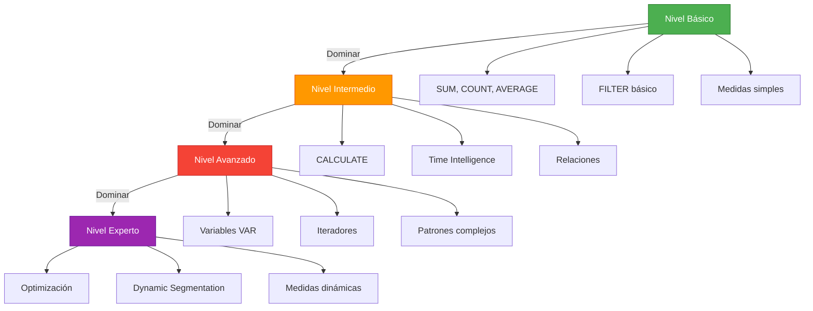
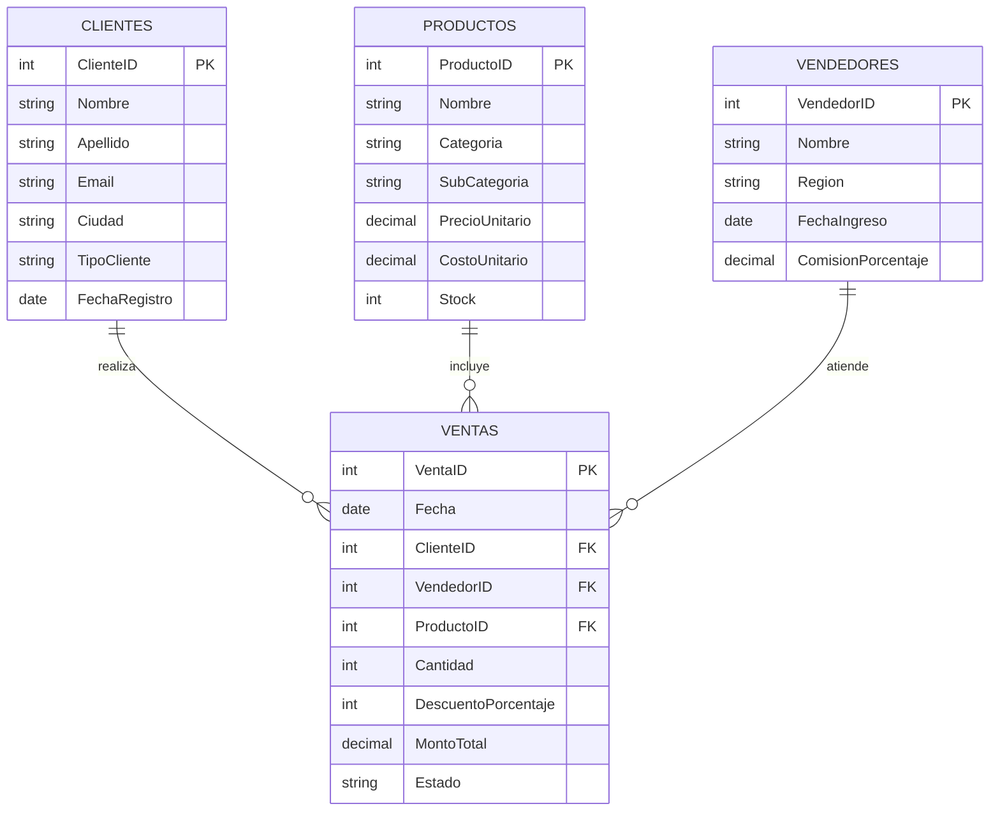

# Módulo 08: Ejercicios DAX Progresivos

## Descripción

Ejercicios prácticos de DAX organizados por nivel de dificultad. Cada ejercicio incluye contexto de negocio, modelo de datos, desafío y solución detallada.

## Estructura de Ejercicios



## Niveles de Dificultad

| Nivel | Archivo | Temas Cubiertos | Ejercicios | Tiempo |
|:-----:|---------|-----------------|:----------:|:------:|
| Básico | [Ejercicios Básicos](01_Nivel_Basico/Ejercicios_Basicos.md) | SUM, COUNT, AVERAGE, MIN, MAX | 10 | 2 h |
| Intermedio | [Ejercicios Intermedios](02_Nivel_Intermedio/Ejercicios_Intermedios.md) | CALCULATE, FILTER, ALL | 8 | 3 h |
| Avanzado | [Ejercicios Avanzados](03_Nivel_Avanzado/Ejercicios_Avanzados.md) | VAR, iteradores, time intelligence | 6 | 4 h |
| Experto | [Ejercicios Expertos](04_Nivel_Experto/Ejercicios_Expertos.md) | Patrones, optimización, dinámicos | 5 | 3 h |

## Datos de Práctica

| Archivo | Registros | Descripción |
|---------|:---------:|-------------|
| `clientes.csv` | 500 | Clientes con nombre, email, ciudad y tipo |
| `productos.csv` | 50 | Productos con categoría, precio y stock |
| `vendedores.csv` | 25 | Vendedores por región con comisión |
| `ventas.csv` | 5,000 | Transacciones de 2022-2024 |

### Generar Datos

```bash
cd Datos_Practica
python generar_datos_practica.py
```

## Esquema de Datos



## Cómo Usar Este Módulo

1. **Lee el contexto del negocio** — Entiende el escenario
2. **Revisa el modelo de datos** — Identifica tablas y relaciones
3. **Intenta resolver el ejercicio** — Sin ver la solución
4. **Compara con la solución** — Verifica tu enfoque
5. **Experimenta** — Modifica la solución para aprender más

## Prerrequisitos

- Completar [Módulo 02: DAX](../02_El_Corazon_del_Modelo_DAX/)
- Generar datos de práctica (ver arriba)

## Módulos Relacionados

- [02. DAX - Motor de Cálculo](../02_El_Corazon_del_Modelo_DAX/)
- [07. Casos de Estudio](../07_Casos_de_Estudio_Completos/)
