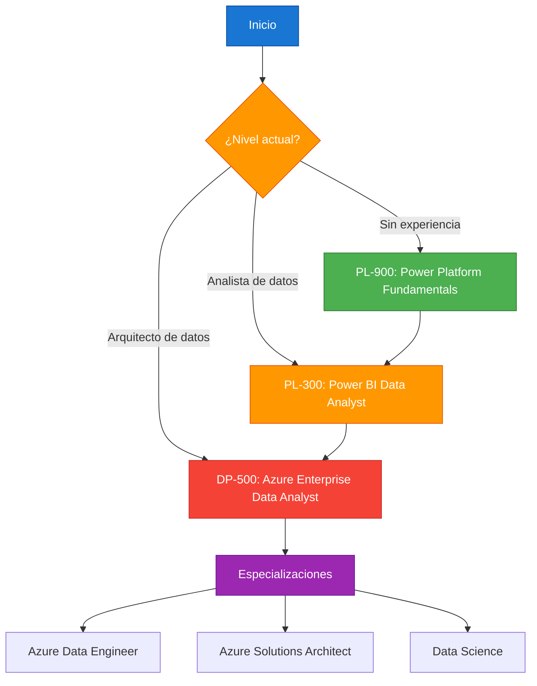

# Módulo 09: Referencias y Recursos

## Descripción

Recursos adicionales para continuar tu aprendizaje en Power BI: libros, certificaciones, comunidades y herramientas complementarias.

## Contenido del Módulo

| # | Archivo | Tema |
|:-:|---------|------|
| 9.1 | [Libros Recomendados](libros_recomendados.md) | Bibliografía esencial de Power BI y DAX |
| 9.2 | [Certificaciones](certificaciones.md) | Ruta de certificación Microsoft |
| 9.3 | [Comunidades y Foros](comunidades_y_foros.md) | Dónde aprender y compartir |
| 9.4 | [Herramientas Complementarias](herramientas_complementarias.md) | Software que potencia Power BI |

## Ruta de Certificación



## Herramientas del Ecosistema

```mermaid
flowchart LR
    subgraph Herramientas["Herramientas Power BI"]
        A[Power BI Desktop]
        B[Power BI Service]
        C[Power BI Mobile]
        D[Power BI Report Server]
    end
    
    subgraph Complementarias["Herramientas Complementarias"]
        E[Tabular Editor]
        DAX Studio
        F[Power BI Helper]
        G[ALM Toolkit]
    end
    
    subgraph Datos["Fuentes de Datos"]
        H[SQL Server]
        I[Excel]
        J[APIs REST]
        K[Archivos CSV]
    end
    
    Datos --> Herramientas
    Herramientas --> Complementarias
    
    style Herramientas fill:#1976d2,stroke:#0d47a1,color:#fff
    style Complementarias fill:#4caf50,stroke:#2e7d32,color:#fff
    style Datos fill:#ff9800,stroke:#e65100,color:#fff
```

## Prerrequisitos

- Ninguno. Módulo de referencia abierto.

## Módulo Anterior → [08: Ejercicios DAX](../08_Ejercicios_DAX_Progresivos/)
