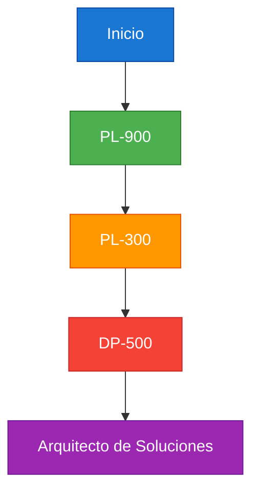
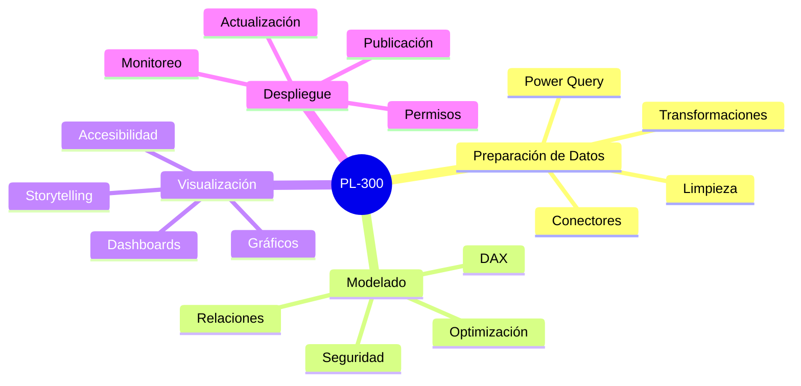
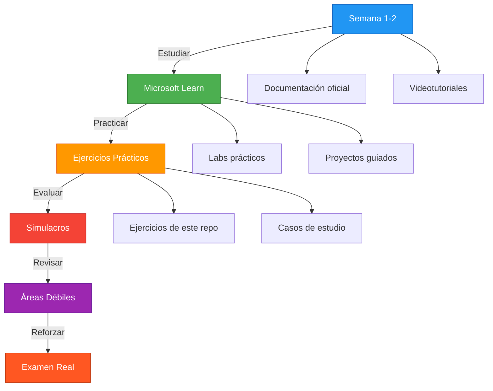

# Certificaciones Microsoft en Power BI

> Guía completa de las certificaciones relacionadas con Power BI y análisis de datos.

## Ruta de Certificación

---

## PL-900: Microsoft Power Platform Fundamentals

| Campo | Detalle |
|-------|---------|
| **Nivel** | Fundamentos |
| **Experiencia requerida** | Ninguna |
| **Costo** | USD 99 |
| **Duración** | 45-60 minutos |
| **Puntuación mínima** | 700/1000 |

### Temas Cubiertos

| Tema | Porcentaje |
|------|:----------:|
| Describir la funcionalidad de Power BI | 20-25% |
| Describir la funcionalidad de Power Apps | 20-25% |
| Describir la funcionalidad de Power Automate | 25-30% |
| Describir la funcionalidad de Power Virtual Agents | 15-20% |

### Recursos de Estudio

- [Microsoft Learn PL-900](https://learn.microsoft.com/training/paths/power-platform-fundamentals/)
- Prácticas en [Microsoft Virtual Training Days](https://www.microsoft.com/es-es/training-days/)

---

## PL-300: Microsoft Power BI Data Analyst Associate

| Campo | Detalle |
|-------|---------|
| **Nivel** | Asociado |
| **Experiencia requerida** | 6-12 meses con Power BI |
| **Costo** | USD 165 |
| **Duración** | 100-120 minutos |
| **Puntuación mínima** | 700/1000 |

### Temas Cubiertos

| Tema | Porcentaje |
|------|:----------:|
| Preparar los datos en Power BI | 25-30% |
| Modelar los datos en Power BI | 25-30% |
| Analizar y visualizar datos en Power BI | 25-30% |
| Desplegar y mantener activos | 15-20% |

### Habilidades Requeridas

### Recursos de Estudio

- [Microsoft Learn PL-300](https://learn.microsoft.com/training/paths/power-bi-data-analyst/)
- [Ejercicios de este repositorio](../08_Ejercicios_DAX_Progresivos/)
- Prácticas en [Exam Sandbox](https://aka.ms/exampl-demo)

---

## DP-500: Azure Enterprise Data Analyst Associate

| Campo | Detalle |
|-------|---------|
| **Nivel** | Asociado (Avanzado) |
| **Experiencia requerida** | 2-3 años de experiencia en análisis de datos |
| **Costo** | USD 165 |
| **Duración** | 100-120 minutos |
| **Puntuación mínima** | 700/1000 |

### Temas Cubiertos

| Tema | Porcentaje |
|------|:----------:|
| Implementar y gestión de entornos de análisis | 20-25% |
| Gestionar el análisis de datos | 25-30% |
| Modelar datos en Azure | 25-30% |
| Explorar y analizar datos | 20-25% |

### Prerrequisitos Recomendados

- Experiencia con Azure SQL Database
- Conocimientos de Synapse Analytics
- Dominio de Power BI Service

---

## Preparación para Exámenes

### Metodología de Estudio Recomendada

### Consejos para el Examen

1. **Practica con datos reales** — No solo teoría
2. **Domina DAX** — Es la base de PL-300 y DP-500
3. **Conoce Power BI Service** — Publicación, permisos, actualización
4. **Entiende la gobernanza** — RLS, cumplimiento, monitoreo
5. **Haz simulacros** — Familiarízate con el formato del examen

---

## Beneficios de la Certificación

| Beneficio | Descripción |
|-----------|-------------|
| Reconocimiento profesional | Validación oficial de tus habilidades |
| Mejores oportunidades laborales | Las empresas valoran las certificaciones Microsoft |
| Acceso a comunidades exclusivas | Red de profesionales certificados |
| Actualizaciones gratuitas | Acceso a nuevas versiones de exámenes |
| Descuentos en eventos | Conferencias y capacitaciones de Microsoft |
