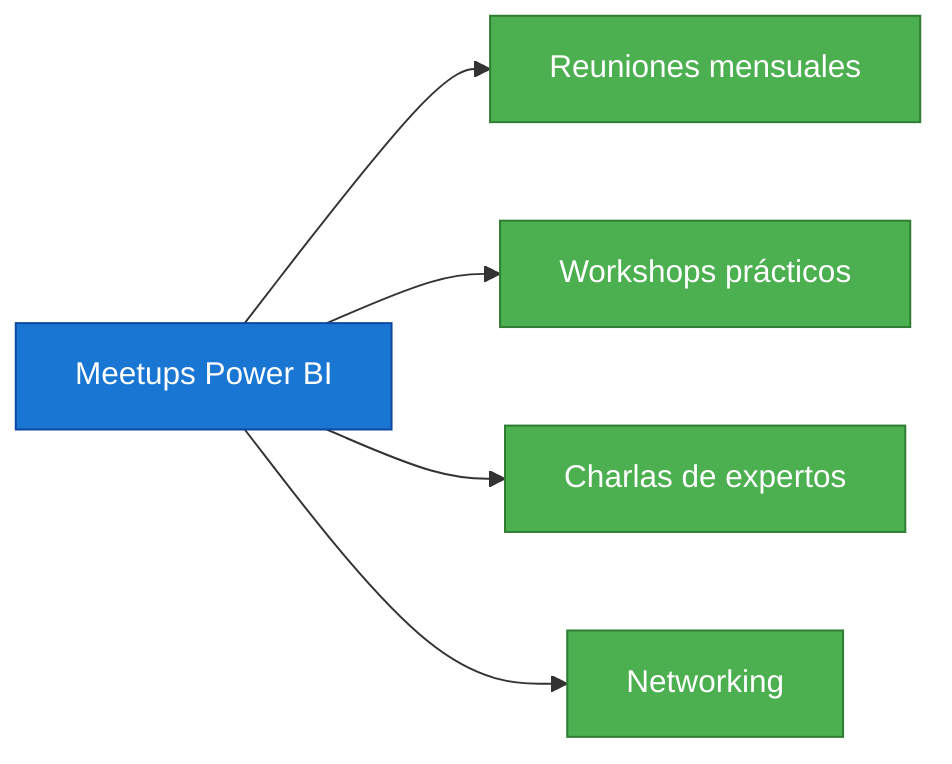
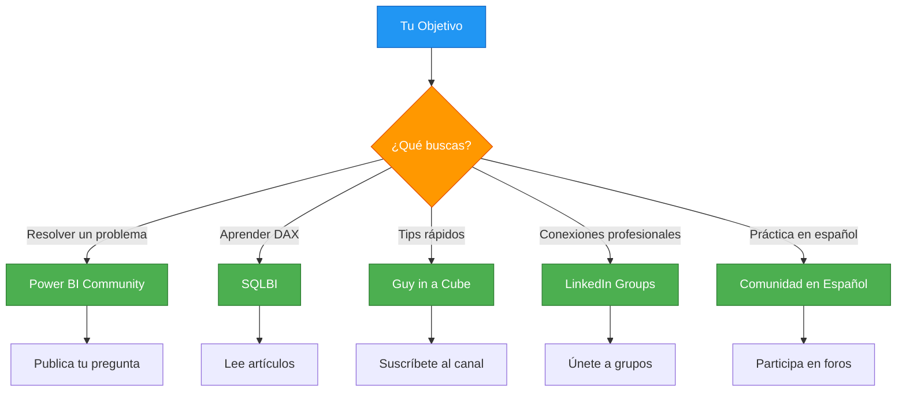

# Comunidades y Foros de Power BI

> Recursos para conectar con otros profesionales, aprender y resolver dudas.

## Comunidades Principales

### 1. Power BI Community (Microsoft)

| Campo | Detalle |
|-------|---------|
| **URL** | [community.powerbi.com](https://community.powerbi.com) |
| **Tipo** | Foro oficial Microsoft |
| **Idioma** | Inglés (con secciones en español) |
| **Miembros** | +500,000 |

**Características:**
- Foros organizados por temas
- Blogs de la comunidad
- Ideas para el producto
- Eventos y webinars

### 2. SQLBI

| Campo | Detalle |
|-------|---------|
| **URL** | [sqlbi.com](https://www.sqlbi.com) |
| **Tipo** | Blog y recursos de DAX |
| **Autores** | Alberto Ferrari, Marco Russo |
| **Contenido** | Artículos técnicos, vídeos, herramientas |

**Recursos destacados:**
- Artículos sobre DAX y modelado
- Vídeos en YouTube (SQLBI)
- Herramientas gratuitas (DAX Studio, VertiPaq Analyzer)

### 3. Guy in a Cube

| Campo | Detalle |
|-------|---------|
| **URL** | [guyinacube.com](https://guyinacube.com) |
| **Tipo** | Canal de YouTube |
| **Presentadores** | Adam Saxton, Patrick LeBlanc |
| **Contenido** | Tutoriales, consejos, novedades |

**Temas frecuentes:**
- Tips y trucos de Power BI
- Actualizaciones mensuales
- Mejores prácticas
- Respuestas a preguntas de la comunidad

---

## Foros y Grupos en Español

### 4. Comunidad Power BI en Español

| Campo | Detalle |
|-------|---------|
| **URL** | [community.powerbi.com/t5/Power-BI-Español/](https://community.powerbi.com/t5/Power-BI-Espa%C3%B1ol/bd-p/Power-BI-Espa%C3%B1ol) |
| **Tipo** | Sección en español del foro oficial |
| **Moderadores** | Profesionales certificados |

### 5. Grupos de LinkedIn

| Grupo | Miembros | Enfoque |
|-------|:--------:|---------|
| Power BI Users | +200,000 | Usuarios generales |
| Power BI Developers | +50,000 | Desarrolladores |
| DAX - Data Analysis Expressions | +30,000 | Especialistas en DAX |
| Power BI en Español | +20,000 | Comunidad hispanohablante |

### 6. Meetups y Eventos Locales

---

## Canales de YouTube Recomendados

| Canal | Idioma | Suscriptores | Enfoque |
|-------|:------:|:------------:|---------|
| Guy in a Cube | Inglés | 400K+ | Tutoriales y tips |
| SQLBI | Inglés | 200K+ | DAX y modelado |
| Pragmatic Works | Inglés | 150K+ | Formación empresarial |
| Curbal | Inglés | 100K+ | Power Query y DAX |
| Productival | Español | 50K+ | Power BI en español |
| Biomics | Español | 30K+ | Análisis de datos |

---

## Recursos de Aprendizaje Continuo

### Newsletters

| Newsletter | Frecuencia | Contenido |
|------------|:----------:|-----------|
| Power BI Weekly | Semanal | Novedades, artículos, herramientas |
| SQLBI Newsletter | Mensual | Artículos técnicos, eventos |
| Guy in a Cube | Semanal | Resumen de vídeos, tips |

### Podcasts

| Podcast | Temática | Frecuencia |
|---------|----------|:----------:|
| Guy in a Cube | Power BI y análisis | Semanal |
| Power BI Tips | Consejos prácticos | Semanal |
| Data Stories | Historias con datos | Mensual |

---

## Cómo Elegir Dónde Participar

---

## Consejos para Participar

1. **Sé específico** — Describe tu problema con ejemplos concretos
2. **Comparte datos de ejemplo** — Facilita la ayuda
3. **Agradece** — Reconoce la ayuda recibida
4. **Comparte conocimiento** — Responde preguntas cuando puedas
5. **Sé respetuoso** — Mantén un tono profesional
