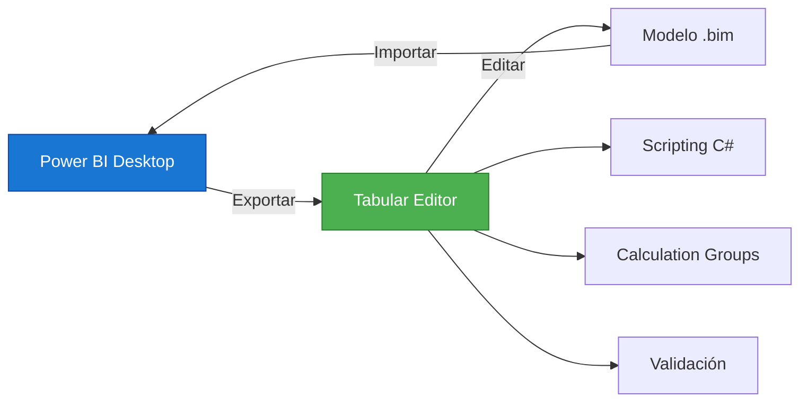
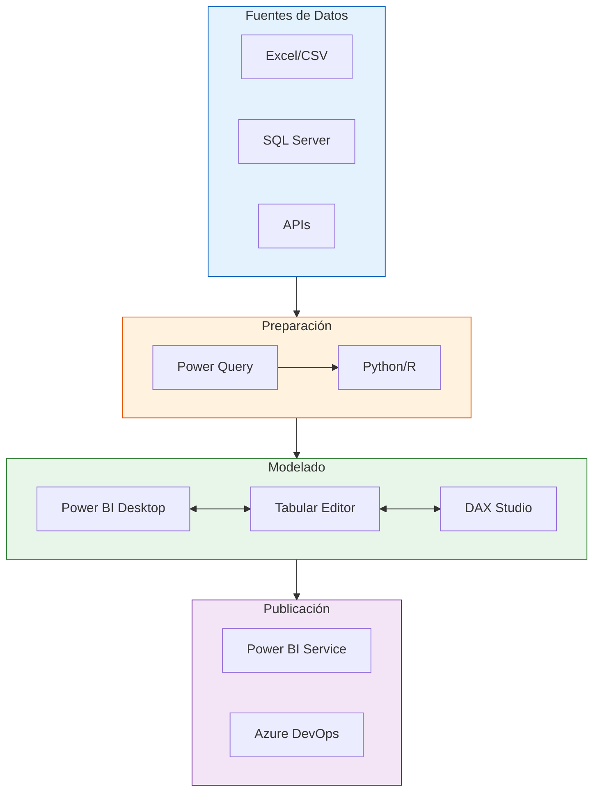

# Herramientas Complementarias para Power BI

> Software y extensiones que potencian tu productividad con Power BI.

## Herramientas Principales

### 1. Tabular Editor

| Campo | Detalle |
|-------|---------|
| **URL** | [tabulareditor.com](https://www.tabulareditor.com) |
| **Precio** | Gratuito (Community) / De pago (Professional) |
| **Plataforma** | Windows |
| **Función** | Edición de modelos tabulares |

**Características:**
- Edición de modelos tabular fuera de Power BI Desktop
- Scripting con C# y DAX
- Versionado de modelos con Git
- Medidas Calculation Groups



---

### 2. DAX Studio

| Campo | Detalle |
|-------|---------|
| **URL** | [daxstudio.org](https://daxstudio.org) |
| **Precio** | Gratuito (open source) |
| **Plataforma** | Windows |
| **Función** | Consultas DAX y diagnóstico |

**Características:**
- Ejecución y análisis de consultas DAX
- Métricas de rendimiento de consultas
- Exportación de datos
- Análisis de modelo (VertiPaq Analyzer)

**Uso típico:**
```dax
-- DAX Studio permite ejecutar y analizar:
EVALUATE
SUMMARIZE(
    Ventas,
    Ventas[Categoria],
    "Total Ventas", SUM(Ventas[MontoTotal])
)
```

---

### 3. Power BI Helper

| Campo | Detalle |
|-------|---------|
| **URL** | [powerbihelper.com](https://www.powerbihelper.com) |
| **Precio** | Gratuito / De pago |
| **Plataforma** | Windows |
| **Función** | Utilidades de modelado |

**Funciones principales:**
- Generación automática de documentación
- Análisis de relaciones
- Optimización de modelo
- Comparación de versiones

---

### 4. ALM Toolkit

| Campo | Detalle |
|-------|---------|
| **URL** | [github.com/microsoft/Analysis-Services-ALM-Toolkit](https://github.com/microsoft/Analysis-Services-ALM-Toolkit) |
| **Precio** | Gratuito (Microsoft) |
| **Plataforma** | Windows |
| **Función** | Gestión de modelos y despliegue |

**Características:**
- Comparación de modelos
- Despliegue incremental
- Validación de cambios
- Integración con Azure DevOps

---

## Extensiones de Power BI Desktop

### 5. Power BI Visuals Gallery

| Visual | Autor | Uso |
|--------|-------|-----|
| Decomposition Tree | Microsoft | Análisis de descomposición |
| Key Influencers | Microsoft | Factores influyentes |
| Smart Narratives | Microsoft | Narrativas automáticas |
| Drillthrough Buttons | Comunidad | Navegación mejorada |

### 6. Paletas de Colores

| Herramienta | Descripción |
|-------------|-------------|
| [Coolors](https://coolors.co) | Generador de paletas |
| [ColorBrewer](https://colorbrewer2.org) | Paletas para datos |
| [Visme](https://www.visme.co/colors) | Paletas armónicas |

---

## Herramientas de Desarrollo

### 7. Visual Studio Code con Extensiones

| Extensión | Función |
|-----------|---------|
| Power BI Desktop Tools | Edición de DAX |
| DAX Formatter | Formateo automático de DAX |
| Markdown All in One | Edición de documentación |
| Git Lens | Control de versiones mejorado |

### 8. GitHub + Azure DevOps

| Herramienta | Uso |
|-------------|-----|
| GitHub | Repositorios y versionado |
| Azure Pipelines | CI/CD para modelos |
| Azure DevOps | Gestión de proyectos |

---

## Herramientas de Datos

### 9. Conectores Adicionales

| Conector | Fuente |
|----------|--------|
| CData Power BI Connectors | Bases de datos adicionales |
| Power BI OData Connector | Servicios REST |
| Custom Data Connector | Fuentes personalizadas |

### 10. Preparación de Datos

| Herramienta | Función |
|-------------|---------|
| Excel | Análisis exploratorio |
| Python/R | Estadística avanzada |
| SQL Server Management Studio | Consultas SQL |
| Azure Data Factory | ETL en la nube |

---

## Flujo de Trabajo Recomendado



---

## Comparativa de Herramientas

| Herramienta | Precio | Curva Aprendizaje | Recomendada Para |
|-------------|:------:|:-----------------:|------------------|
| Tabular Editor | Gratis/Pago | Media | Modeladores |
| DAX Studio | Gratis | Baja | Todos |
| Power BI Helper | Gratis/Pago | Baja | Analistas |
| ALM Toolkit | Gratis | Alta | Desarrolladores |
| VS Code | Gratis | Media | Desarrolladores |

---

## Recursos de Instalación

### Tabular Editor
```bash
# Instalar con Chocolatey
choco install tabulareditor

# O descargar desde:
# https://www.tabulareditor.com/downloads
```

### DAX Studio
```bash
# Instalar con Chocolatey
choco install daxstudio

# O descargar desde:
# https://daxstudio.org/downloads/
```

---

## Consejos para Elegir Herramientas

1. **Empieza con lo básico** — DAX Studio y Power BI Desktop
2. **Agrega herramientas gradualmente** — Según tus necesidades
3. **Aprende una a la vez** — No intentes dominar todo de golpe
4. **Comunícate con la comunidad** — Pide recomendaciones
5. **Actualiza regularmente** — Las herramientas mejoran constantemente
