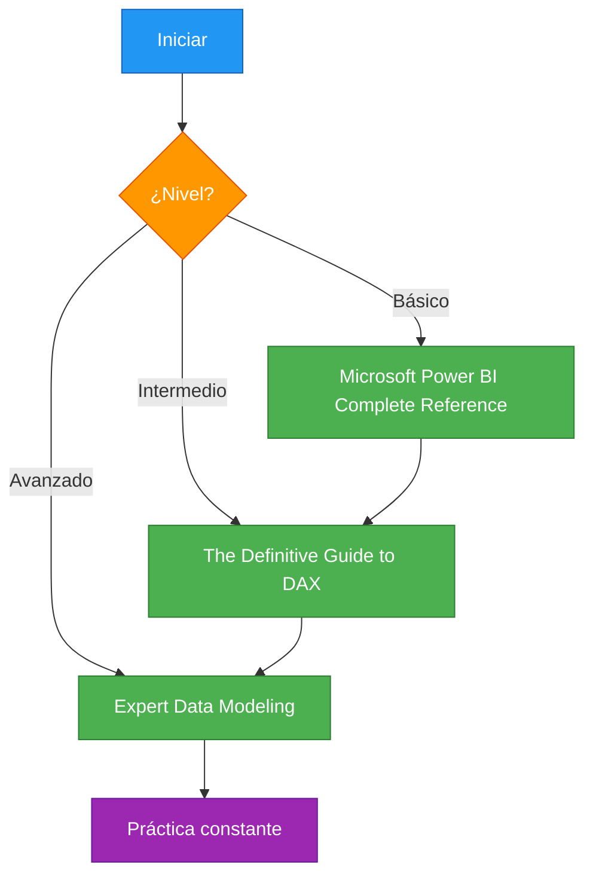

# Libros Recomendados sobre Power BI

> Libros esenciales para dominar Power BI y DAX, organizados por nivel.

## Nivel Básico

### 1. Microsoft Power BI Complete Reference Guide
- **Autores:** Miguel Escobar, Ken Puls
- **Edición:** 2023
- **Descripción:** Guía completa que cubre desde los fundamentos hasta técnicas avanzadas. Ideal para principiantes.
- **Capítulos clave:**
  - Introducción a Power BI
  - Power Query desde cero
  - Primeros pasos con DAX

### 2. Power BI en español
- **Autores:** Varios autores
- **Descripción:** Recursos y tutoriales en español para aprender Power BI desde cero.

## Nivel Intermedio

### 3. The Definitive Guide to DAX
- **Autores:** Alberto Ferrari, Marco Russo (SQLBI)
- **Edición:** 2023
- **Descripción:** La biblia de DAX. Explica a fondo el motor de cálculo, contextos y patrones.
- **Capítulos clave:**
  - Contexto de filtro
  - Contexto de fila
  - Transición de contexto
  - Patrones DAX

### 4. Analyzing Data with Power BI and Power Pivot for Excel
- **Autores:** Marco Russo, Alberto Ferrari
- **Descripción:** Enfoque práctico en modelado de datos y DAX para analistas.

## Nivel Avanzado

### 5. Tabular Model SSAS 2016/2019/2022 Cookbook
- **Autores:** Dexter Minglana
- **Descricción:** Técnicas avanzadas de modelado tabular, rendimiento y escalabilidad.

### 6. Expert Data Modeling with Power BI
- **Autores:** Greg Deckler
- **Edición:** 2022
- **Descricción:** Patrones avanzados, modelos complejos y optimización empresarial.

## Recursos en Español

| Recurso | Tipo | URL |
|---------|------|-----|
| Blog de Power BI (Microsoft) | Blog | powerbi.microsoft.com/blog |
| Comunidad Power BI | Foro | community.powerbi.com |
| SQLBI (artículos en español) | Blog | sqlbi.com |
| Guy in a Cube (YouTube) | Video | youtube.com/guyinacube |

## Recomendaciones de Lectura

