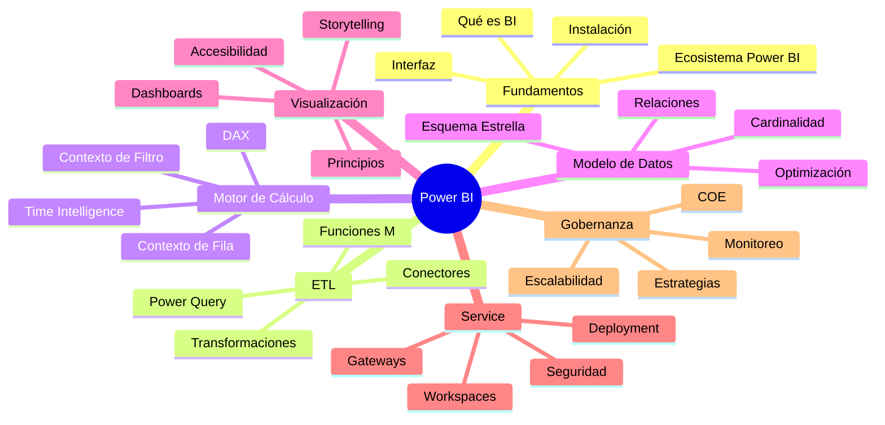
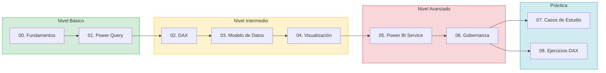

# Apuntes de Power BI

> **Repositorio profesional de aprendizaje y referencia de Microsoft Power BI.**
> Desde fundamentos básicos hasta arquitectura empresarial nivel experto.

---

## Acerca de Este Proyecto

Este repositorio contiene una colección estructurada de apuntes técnicos sobre Microsoft Power BI, diseñada para acompañarte desde tu primer contacto con la herramienta hasta la implementación de soluciones empresariales de nivel avanzado.



---

## Tabla de Contenidos

### Módulos de Aprendizaje

| # | Módulo | Nivel | Tiempo Est. | Archivos |
|:-:|--------|:-----:|:-----------:|:--------:|
| 00 | [Fundamentos Esenciales](00_Fundamentos_Esenciales/) | Básico | 4 h | 5 |
| 01 | [Power Query (ETL)](01_Alquimia_de_Datos_con_Power_Query/) | Básico-Intermedio | 6 h | 3+ |
| 02 | [DAX - Motor de Cálculo](02_El_Corazon_del_Modelo_DAX/) | Intermedio-Avanzado | 10 h | 3+ |
| 03 | [Modelo de Datos](03_Arquitectura_del_Modelo_de_Datos/) | Intermedio | 5 h | 2+ |
| 04 | [Visualización y Storytelling](04_Visualizacion_y_Storytelling_con_Datos/) | Intermedio | 4 h | 2+ |
| 05 | [Power BI Service](05_Power_BI_Service_y_Colaboracion/) | Intermedio | 5 h | 3+ |
| 06 | [Gobernanza Empresarial](06_Gobernanza_y_Escalabilidad_Empresarial/) | Avanzado | 6 h | 3+ |

### Práctica y Casos de Estudio

| # | Módulo | Nivel | Tiempo Est. | Archivos |
|:-:|--------|:-----:|:-----------:|:--------:|
| 07 | [Casos de Estudio](07_Casos_de_Estudio_Completos/) | Todos | 37 h | 6+ |
| 08 | [Ejercicios DAX](08_Ejercicios_DAX_Progresivos/) | Progresivo | 12 h | 4+ |
| 09 | [Referencias y Recursos](09_Referencias_y_Recursos/) | Todos | — | 4 |

### Casos de Estudio Disponibles

| Caso | Industria | Nivel | Tiempo |
|------|-----------|:-----:|:------:|
| [Ventas Retail](07_Casos_de_Estudio_Completos/Ventas_Retail/) | Comercio | Intermedio-Avanzado | 4 h |
| [Recursos Humanos](07_Casos_de_Estudio_Completos/Recursos_Humanos/) | Gestión de Talento | Intermedio | 3 h |
| [Compras y Suministro](07_Casos_de_Estudio_Completos/Compras_Cadena_Suministro/) | Manufactura | Intermedio-Avanzado | 6 h |
| [Mantenimiento Industrial](07_Casos_de_Estudio_Completos/Mantenimiento_Industrial/) | Producción | Avanzado | 8 h |
| [Seguridad Industrial](07_Casos_de_Estudio_Completos/Seguridad_Industrial/) | Manufactura | Intermedio-Avanzado | 6 h |
| [Power BI + IA + MCP](07_Casos_de_Estudio_Completos/PowerBI_IA_MCP/) | Tecnología | Experto | 10 h |

---

## Ruta de Aprendizaje



---

## Inicio Rápido

### Para Estudiantes

```bash
# 1. Clonar el repositorio
git clone https://github.com/tu-usuario/Apuntes_de_power_BI.git

# 2. Navegar a la carpeta
cd Apuntes_de_power_BI

# 3. Generar datos de práctica (opcional)
cd 08_Ejercicios_DAX_Progresivos/Datos_Practica
python generar_datos_practica.py
```

### Para Profesionales

1. Consulta directamente los [casos de estudio](07_Casos_de_Estudio_Completos/)
2. Revisa la [gobernanza](06_Gobernanza_y_Escalabilidad_Empresarial/) para arquitectura empresarial
3. Usa los [ejercicios DAX](08_Ejercicios_DAX_Progresivos/) para refrescar habilidades

---

## Estructura del Repositorio

```text
Apuntes_de_power_BI/
│
├── .github/                    Configuración de GitHub
├── assets/                     Recursos compartidos
│   ├── images/                 Capturas y diagramas
│   ├── data/                   Datos de ejemplo
│   └── templates/              Plantillas reutilizables
│
├── 00_Fundamentos_Esenciales/  Módulo 00
├── 01_Power_Query/             Módulo 01
├── 02_DAX/                     Módulo 02
├── 03_Modelo_Datos/            Módulo 03
├── 04_Visualizacion/           Módulo 04
├── 05_Service/                 Módulo 05
├── 06_Gobernanza/              Módulo 06
├── 07_Casos_Estudio/           Módulo 07
├── 08_Ejercicios_DAX/          Módulo 08
├── 09_Referencias/             Módulo 09
│
├── README.md                   Este archivo
├── LICENSE                     Licencia MIT
├── CONTRIBUTING.md             Guía de contribución
├── CHANGELOG.md                Historial de cambios
└── MANUAL_PROFESIONAL.md       Estándares del proyecto
```

---

## Niveles de Dificultad

| Nivel | Color | Descriptor | Público Objetivo |
|:-----:|:-----:|------------|------------------|
| Básico | 🟢 | Sin experiencia previa | Estudiantes, profesionales de otras áreas |
| Intermedio | 🟡 | Conoce fundamentos de Power BI | Analistas de datos, reportadores |
| Avanzado | 🟠 | Busca especialización | Desarrolladores Power BI, consultores |
| Experto | 🔴 | Nivel arquitecto | Arquitectos de datos, líderes técnicos |

---

## Contenido Destacado

### Glosarios Técnicos
Cada módulo incluye un glosario alfabético de términos especializados:
- [Glosario Fundamentos](00_Fundamentos_Esenciales/00_Glosario_Fundamentos.md)
- [Glosario Power Query](01_Alquimia_de_Datos_con_Power_Query/01_Glosario_Power_Query.md)

### Ejercicios Progresivos
4 niveles de ejercicios DAX con soluciones:
- Básico → Intermedio → Avanzado → Experto

### Casos de Estudio Reales
- Ventas Retail con modelo dimensional completo
- Recursos Humanos con análisis de nómina

---

## Contribuir

Lee la [guía de contribución](CONTRIBUTING.md) para:
- Reportar errores o contenido desactualizado
- Sugerir mejoras o nuevos temas
- Agregar ejercicios con soluciones
- Corregir erratas

---

## Licencia

Este proyecto está bajo la [Licencia MIT](LICENSE).

---

## Contacto

**Jorge Sislema**
- GitHub: [@tu-usuario](https://github.com/tu-usuario)

---

## Reconocimientos

Gracias a la comunidad de Power BI por su constante inspiración y conocimiento compartido.
